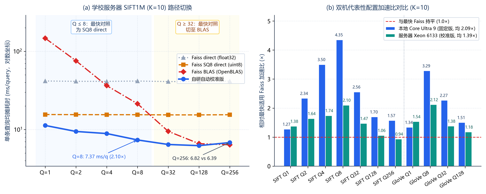
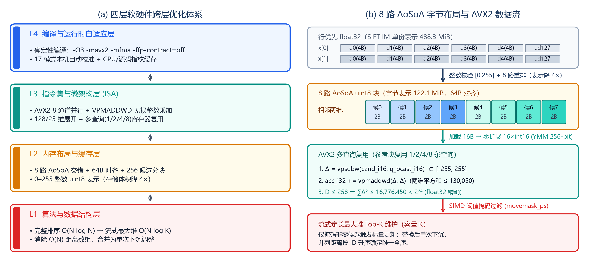

# 面向批量精确向量检索的 CPU 跨层性能优化

**课程完整材料：** [完整复现ZIP（含全部负载）](https://github.com/KINGJIJI0115/cpu-exact-vector-search/releases/download/v1.0-course/cpu-exact-vector-search-v1.0-course-full.zip) · [报告PDF](https://github.com/KINGJIJI0115/cpu-exact-vector-search/releases/download/v1.0-course/course-report.pdf) · [Release页面](https://github.com/KINGJIJI0115/cpu-exact-vector-search/releases/tag/v1.0-course)


作者：赵信喆。软件系统优化课程项目。

从基础精确向量检索实现出发，优化 Top-K 选择、数据布局与 AVX2 距离计算，并在新机器上自动选择自研内核。Faiss 是性能对照，不参与自研搜索计算。

## 主要结果

| 机器及方案 | 领先最快适用 Faiss 的测试项 | 几何平均加速比 |
|---|---:|---:|
| 本地 Core Ultra 9 275HX，固定版 | 78/78 | 2.086× |
| 学校 Xeon Gold 6133，自动校准版 | 67/78 | 1.393× |

确认实验覆盖 SIFT1M 和 GloVe25 的26种配置、每配置3批查询；搜索及 Faiss/BLAS 均为单线程，固定 `OPENBLAS_CORETYPE=Haswell`。SIFTsmall 用于前期瓶颈分析和分层消融，不计入78项。服务器自动校准版78项正确性均通过。上述数字来自归档实验，新机器生成自己的结果。



## 优化方法

- 算法：从完整排序改为部分选择与流式最大堆，减少 Top-K 开销。
- 数据布局：AoSoA、对齐和分块；符合整数条件的 SIFT 使用无损字节表示。
- 指令与计算：自研 AVX2、固定维度展开及多查询复用。
- 运行时：17种候选模式，独立校准与验证后冻结选择；按机器、构建和数据指纹缓存结果。



## 最方便的完整复现方式

**老师复现请下载本仓库 Releases 中的“cpu-exact-vector-search-v1.0-course-full.zip”，不要使用 GitHub 自动生成的 Source code ZIP 代替。完整包附带三个负载和历史证据，无须另找数据。** 仓库及Release设置为Public，老师无需申请仓库权限。

解压完整包，在 Ubuntu/WSL 终端执行：

```bash
python3 verify_bundle.py
bash reproduce.sh --quick   # 编译、回归、形式化检查及生成报告
bash reproduce.sh           # 校准26配置，再做78项Faiss对照
```

完整模式通常需要数小时；快速模式不测性能。首次安装依赖需要网络和必要的安装权限。

## 从本源码仓库运行

本仓库保留核心代码、报告和主要原始结果，不跟踪原始负载、编译产物及运行缓存。先在首次修改文件前校验，然后可进行快速验收：

```bash
python3 verify_bundle.py
bash reproduce.sh --quick
```

完整运行前，从自己下载的完整复现包导入经过校验的数据（只提取负载，不覆盖源码）：

```bash
python3 tools/import_release_data.py /path/to/cpu-exact-vector-search-v1.0-course-full.zip
bash reproduce.sh
```

源码版与完整包各有自己的 MANIFEST，不能互换。源码版导入数据后会增加未跟踪文件，不影响原有源码校验。

## 环境与输出

Ubuntu 22.04 / WSL Ubuntu，Python 3.10+，x86-64 CPU需支持AVX2/FMA。入口自动检查工具和安装固定Python依赖。可使用 `--cpu <允许的逻辑CPU编号>` 指定CPU。

新结果保存在 `results/autotune_时间戳/`：`steps.json`记录步骤，`SUCCESS.json`记录完成状态，`confirmation/`保存完整模式的78项结果，`report/`保存本机报告。流程成功与性能领先数量分开记录，快速模式的性能状态是 `not_evaluated`。

## 阅读导航

| 内容 | 路径 |
|---|---|
| 课程报告及图表 | [report/](report/) |
| 默认内核、校准与测试 | [autotune/](autotune/) |
| 固定版内核与前期方法 | [baseline/src/](baseline/src/) |
| 学校服务器78项记录 | [evidence/faiss78/summary.csv](evidence/faiss78/summary.csv) |
| 本地结果与配图来源 | [report/figures/SOURCES.md](report/figures/SOURCES.md) |
| 图表与PDF生成 | [packaging/](packaging/) |
| 复现详细说明 | [REPRODUCE.md](REPRODUCE.md) |
| 数据来源和第三方说明 | [DATA_SOURCES.md](DATA_SOURCES.md) |
| 本次发布说明 | [docs/RELEASE_NOTES.md](docs/RELEASE_NOTES.md) |

## 报告重建

```bash
python3 packaging/generate_figures.py
python3 packaging/render_report.py
```

图表脚本读取本仓库保留的实验记录。需安装 matplotlib、numpy、reportlab 和中文字体；完整复现入口会检查相关依赖。重建会修改图表/PDF，原始MANIFEST用于重建前校验。

## 公开发布与数据说明

本仓库及Release采用公开可见性。下载页面位于仓库右侧Releases，选择 `v1.0-course`，下载 `cpu-exact-vector-search-v1.0-course-full.zip` 和 `course-report.pdf`；完整包中已附全部负载。软件依赖首次安装仍可能联网。

数据来源及再分发核查见 [DATA_SOURCES.md](DATA_SOURCES.md)：GloVe已找到上游PDDL许可，SIFTsmall仅找到镜像MIT标注，SIFT1M的上游再分发声明尚未核实。完整附件的技术准备不代表全部数据授权均已确认。作者姓名、学号按课程署名保留；代码尚未指定开源许可证。

源码发布版先前已通过快速验收、数据导入和图表/PDF重建，见 [验收记录](docs/VALIDATION.md)。

公开版完整ZIP的最新验收见 [PUBLIC_VALIDATION.md](docs/PUBLIC_VALIDATION.md)，包含禁止联网条件下的数据准备测试。
