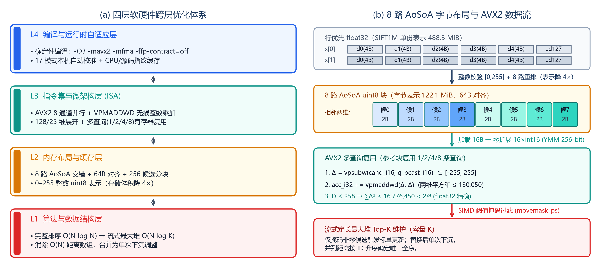
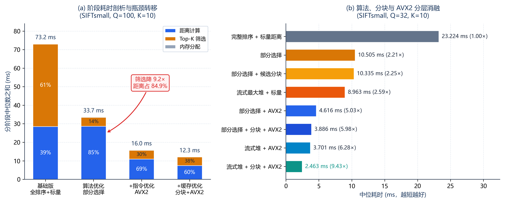
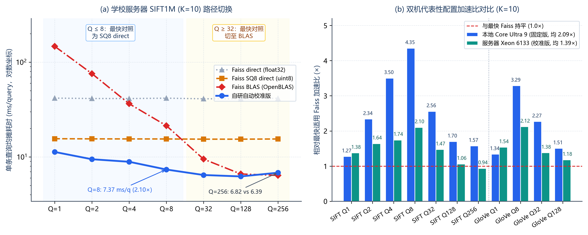
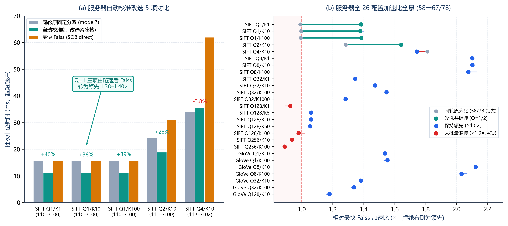
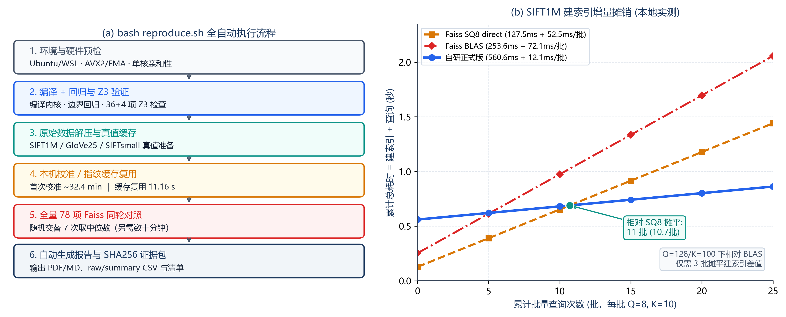

# 面向批量精确向量检索的 CPU 跨层性能优化

姓名：赵信喆　学号：51295903131

课程：软件系统优化　日期：2026年11月25日

## 摘要

精确最近邻检索（Exact kNN）要求在百万级常驻内存向量库上计算批量查询与全部参考向量的平方 L2 距离并返回前 K 个近邻，广泛用于中小规模高精度检索、近似索引的倒排桶扫描与精排（Rerank）以及评测真值生成。针对该负载在通用 CPU 上同时面临的 Top-K 筛选开销、数据表示与局部性瓶颈以及跨微架构性能分化问题，本项目以 SIFT1M 图像描述子与 GloVe25 词向量为真实负载，遵循“基线测量 → 阶段剖析 → 跨层优化 → 验证与复现”的闭环展开系统优化。

剖析初始全排序实现（SIFTsmall，Q=100，K=10）发现，Top-K 筛选占分阶段中位数之和的 60.8%，改为部分选择后筛选开销下降 9.2 倍，瓶颈随即转移至距离计算（占 84.9%）。据此，本文构建了覆盖**算法层、内存与缓存层、指令集与微架构层、编译与运行时自适应层**的四层软硬件协同优化方案：采用流式定长最大堆消除全量距离数组；设计 8 路 AoSoA 交错布局、64 字节对齐、256 候选分块与无损 `uint8` 字节表示（单份数据表示体积降低 4 倍）；结合 AVX2 intrinsic（`VPMADDWD` 无损整数乘加）、多查询寄存器复用与固定维度展开实现高吞吐内核；并针对跨机器性能分化引入基于 CPU/源码 SHA256 指纹的本机自动校准与缓存复用机制。

在本地机器 Intel Core Ultra 9 275HX（WSL Ubuntu 22.04，单线程）上，固定版在 26 个配置 × 3 批查询的 78 项确认测试中**全部领先**最快适用 Faiss 路径，几何平均加速比达 **2.086×**（峰值 **4.60×**）。迁移至学校服务器 Intel Xeon Gold 6133（Ubuntu 22.04，单线程）后，早期固定版领先项降至 57/78（16/26 配置三批全领先，几何平均 1.307×）；引入自动校准后，服务器在 Q=1/2 上自动将 128 维全展开核（`mode 110/111`）改选为紧凑通用字节核（`mode 100`），使 Q=1 提速 1.38–1.40× 并由略微落后转为领先，最新同轮测试领先项由 58/78 提升至 **67/78**（22/26 配置三批全领先），几何平均加速比达 **1.393×**，全部 78 项通过正确性检查。在其余 4 个大批量配置（Q=128/256）上，尽管自研核略慢于固定 Haswell 路径的 OpenBLAS GEMM（0.883–0.99×），仍比 `faiss_sq8_direct` 快 2.29×、比 `faiss_direct` 快 6.16×。本项目配套提供 Z3 形式化验证（36 项有界 Top-K 模型、反例证伪与 4 项无损整数算术引理）、AI 辅助研发与审计记录，以及一键复现脚本（`bash reproduce.sh`；其中服务器首次 26 配置校准约 32.4 分钟，校准缓存复用约 11.16 秒，完整复现另含正确性验证与 78 项性能比较，需预留数小时）。

## 1. 研究问题、应用意义与相关工作

### 1.1 研究问题与真实应用场景

本项目研究常驻内存向量库上的批量精确最近邻检索（Exact kNN Search）。给定包含 N 条 D 维参考向量的数据库 X 与包含 Q 条查询向量的批次 Q_batch，程序需精确计算所有参考向量与每条查询之间的平方 L2 距离，并为每条查询返回距离最小的 K 个候选及其编号（距离相同时按 ID 升序确定唯一全序）。下文统一用 N、D、Q、K 分别表示参考库规模、向量维度、单次调用查询数与返回近邻数。

尽管大规模检索系统常借助 HNSW、IVF-PQ 等近似最近邻（ANN）索引减少计算量，但**精确向量检索在真实生产与科研系统中仍具有不可替代的基础地位**：（1）百万级以下向量库在低延迟或零召回损失约束下（如高精度图像局部特征匹配、敏感风控与特定 RAG 业务）直接执行精确扫描；（2）在 IVF-Flat 倒排索引的桶内扫描及多阶段检索的精排（Rerank）环节，底层算子本质上仍是批量精确 L2 计算与 Top-K 维护；（3）近似索引算法评测所需的基准真值（Ground Truth）亦依赖高效精确检索生成。

| 数据集 | 全库规模 N | 维度 D | 负载来源与预处理口径 |
|---|---|---|---|
| SIFT1M | 1,000,000 | 128 | 真实图像局部描述子；实际坐标均为 0–255 整数，输入保持原始 float32 格式不变 |
| GloVe25 | 1,183,514 | 25 | ANN-Benchmarks 词向量切分；float64 求范数归一化后存为 float32，并重算精确 L2 真值 |
| SIFTsmall | 10,000 | 128 | SIFT 标准子集；专用于阶段耗时剖析与算法/分块/SIMD 分层消融实验 |

三份原始数据归档均随提交包提供 [3][4]。评价指标涵盖每批查询中位耗时（ms）、折算查询吞吐率（Q / 批次耗时，QPS）、建索引耗时（ms）以及索引载荷与进程峰值内存（MiB）。所有查询计时均严格覆盖完整调用链路——包括输入合法性检查、查询编码、距离计算、Top-K 选择与结果输出；数据加载、建索引与首次本机校准耗时则单独记录并分开评估。

### 1.2 相关工作与工业级对照基准

工业界主流向量检索库 Faiss [1] 针对精确平方 L2 检索提供了多条高度优化的执行路径，代表了当前 CPU 精确检索的两类经典范式：

1. **默认调度入口（`faiss_flat`）**：`IndexFlatL2` 的默认搜索入口，依据批量大小 Q 与内部阈值自动在直接计算路径和 BLAS 路径之间切换，实际执行路线随调用配置而变。
2. **强制直接计算路径（`faiss_direct`）**：绕过 BLAS，直接遍历 float32 参考向量并利用 SIMD 累加坐标差平方，即时维护结果堆，适合极小批量（如 Q=1）场景。
3. **强制矩阵乘法路径（`faiss_blas`）**：利用恒等式 ||x - q||^2 = ||x||^2 + ||q||^2 - 2 x·q，将批量距离计算转化为通用矩阵乘法（OpenBLAS SGEMM），在大批量下依靠高算术强度与底层汇编微核获得高吞吐，但在小批量下存在明显的范数与矩阵封装开销。
4. **无损字节直接路径（`faiss_sq8_direct`）**：对于坐标天然为 0–255 整数的 SIFT 数据，Faiss 的 `QT_8bit_direct` [2] 直接以单字节保存坐标而无量化舍入，将单份参考库表示压缩至 float32 的 1/4。

下表总结了自研内核与上述 Faiss 精确/无损路径在核心机制、批量处理与存储上的区别：

| 检索方法 | 距离计算方式 | 批量查询处理方式 | SIFT1M 索引载荷 | 适用数据条件 |
|---|---|---|---|---|
| **自研内核（本文）** | 8 路 AoSoA 直接平方差（整数用 AVX2 `VPMADDWD`，浮点用 FMA） | 256 候选块内 1/2/4/8 查询联合复用 + 流式最大堆 + 本机自动选核 | 610.4 MiB（保留浮点 488.3 + 字节 122.1 双布局） | 任意有限 float32；0–255 整数且 D <= 258 时自动启用无损字节路径 |
| **Faiss direct** | 行优先 float32 SIMD 直接平方差 | 逐查询或小步长遍历，跨查询参考块复用有限 | 488.3 MiB | 任意 float32 |
| **Faiss BLAS** | 范数展开 + OpenBLAS SGEMM | 整批矩阵乘（高算术强度）+ 距离矩阵 Top-K 筛选 | 488.3 MiB | 任意 float32（大批量优势显著） |
| **Faiss SQ8 direct** | 行优先单字节解码后直接 L2 计算 | 逐查询扫描字节库，缺乏跨查询参考块复用 | 122.1 MiB | 0–255 整数输入（该条件下精确无损） |

为保证对照公平，本项目在全部 78 项主实验中同时测量 `faiss_flat`、`faiss_direct`、`faiss_blas` 以及（在 SIFT 上）`faiss_sq8_direct`，**每项测试均取该配置下耗时最短的适用 Faiss 路径作为强基准**。与近似检索（HNSW/IVF-PQ/ScaNN）以牺牲召回率换取速度不同，本项目聚焦精确无损边界下的 CPU 跨层优化。

## 2. 性能剖析与软硬件跨层优化方法

### 2.1 初始基线剖析与瓶颈转移

遵循“先测量剖析、再定向优化”的系统方法论，我们首先在 SIFTsmall（N=10,000, D=128, Q=100, K=10，随机交替重复 21 次，原始记录位于 `baseline/results/perf_20261109T090707225322Z/workload_stat.json`）上对基础程序进行分阶段插桩剖析，分别计算内存分配、距离计算与 Top-K 筛选三个阶段的中位数（下文总耗时口径为**分阶段中位数之和**；同一轮数据的单次总耗时中位数分别为 73.24、33.95、15.99、12.29 ms，两者差值均小于 0.21 ms，见图 2(a)）：

- **第一阶段瓶颈（Top-K 筛选主导）**：原始基线先计算全量 N 个距离再执行完整排序，分阶段中位数之和为 73.20 ms，其中筛选排序高达 **44.51 ms（占比 60.8%）**，超过距离计算的 28.48 ms（38.9%）。在全排序未消除前，仅优化距离内核的整体收益会受阿姆达尔定律制约。
- **瓶颈转移（距离计算主导）**：将完整排序替换为部分选择后，筛选耗时由 44.51 ms 降至 **4.82 ms（下降 9.2×）**，总耗时减半至 33.74 ms；此时**距离计算占比上升至 84.9%（28.64 ms）**，成为最主要的执行瓶颈。
- **访存与计算协同突破**：随后引入 AVX2 向量化与 256 候选缓存分块，距离计算耗时由 28.64 ms 连续压缩至 10.95 ms 与 **7.42 ms（下降 3.86×）**，分阶段中位数之和降至 12.30 ms。进一步用流式最大堆替代全量距离数组（消除 O(N) 写回与二次扫描），最终在全库规模上结合无损字节表示与多查询寄存器复用继续提升性能。

### 2.2 四层软硬件跨层优化体系

基于上述剖析结论，项目在**四个软硬件不同层次**实施了系统性协同优化，各层定位与解决的瓶颈汇总如下表及图 1：

| 优化层次 | 核心技术手段 | 解决的系统瓶颈 |
|---|---|---|
| **L1 算法与数据结构层** | 完整排序 O(N log N) → 流式定长最大堆 O(N log K)；合并单次下沉调整；距离/ID 字典序定全序 | 消除全排序开销与 O(N) 距离数组写回，将筛选占比压低近一个数量级 |
| **L2 内存与缓存体系层** | 8 路 AoSoA 交错布局；64 字节缓存行对齐；256 候选块级缓存分块；0–255 整数无损 `uint8` 表示 | 消除 SIMD 跨步加载开销，提升缓存局部性，将 SIFT 单份数据表示体积降低 **4×**（488.3 MiB → 122.1 MiB） |
| **L3 指令集与微架构层** | AVX2 256-bit 8 通道并行；`VPMADDWD` 无损整数乘加；1/2/4/8 查询寄存器分块；128/25 维编译期展开；SIMD 阈值掩码剪枝 | 充分释放单核 SIMD 吞吐，单次参考块读取复用多条查询，显著减少循环分支与无效堆更新 |
| **L4 编译与运行时自适应层** | `-O3 -mavx2 -mfma -ffp-contract=off` 确定性编译；17 候选模式自动校准；CPU/缓存/源码 SHA256 指纹缓存 | 解决不同 CPU 平台上固定展开策略次优的问题，实现跨机可移植高性能 |

图中 (a) 为自底向上的四层软硬件协同优化架构，(b) 为 SIFT1M（N=1,000,000, D=128）行优先 float32 数据转为 8 路 AoSoA 无损字节表示（488.3 MiB → 122.1 MiB）并经 AVX2 `VPMADDWD` 与流式最大堆完成检索的数据流；存储载荷数据引自 `baseline/results/goal_memory_20261124T054856529211Z/summary.csv`。

### 2.3 算法层：从完整排序到流式定长最大堆

基础实现先为每条查询分配长度为 N 的距离数组，算完后完整排序取前 K 项。实际任务仅需前 K 个结果（通常 K << N）。第一步改用部分选择（`nth_element` + 局部排序），将选择复杂度降至线性期望；第二步进一步升级为**容量固定为 K 的流式最大堆**，边计算距离边维护当前最优 K 个候选。堆顶始终保存当前第 K 小的距离阈值，只有更优候选才触发入堆；同时将堆顶替换与重新建堆合并为**单次向下调整（sift-down）**，既省去 O(N) 距离缓冲的内存分配与缓存污染，又减少了常数开销。当两个候选距离完全相等时，统一按 ID 升序排列，保证跨实现结果严格可复现。

### 2.4 内存与缓存层：8 路 AoSoA、分块与无损字节表示

普通行优先存储将单条向量的 D 个维度连续排列，执行“单条查询对比多条候选”的 SIMD 计算时需频繁执行昂贵的跨步收集（gather）或水平规约。为此，我们设计了 **8 路 AoSoA（Array of Structures of Arrays）交错布局**：每 8 条候选向量的同一维度（或整数路径的相邻两维）紧邻存放，且块起始地址按 **64 字节缓存行对齐**。

计算时，程序将参考库按 **256 条候选**切分为工作块，并在外层将 1/2/4/8 条查询打包联合处理：每个 256 候选块驻留于缓存期间，被组内全部查询连续复用，有效减少重复加载。对于 SIFT 类整数特征，虽然磁盘与接口采用 float32，但坐标实为 0–255 整数。索引构建与查询入口逐项校验该性质（不依赖数据集名称硬编码）；满足条件时以无损 `uint8` 字节格式保存计算载荷，使百万向量的单份数据表示体积由 488.3 MiB 降至 **122.1 MiB（降低 4 倍）**（实际运行时内存访存流量进一步受益于缓存与多查询复用）；若输入包含非整数、超范围坐标或维度超出安全上界，则自动回退至对齐浮点直接平方差路径。

### 2.5 指令集与微架构层：AVX2、`VPMADDWD` 与固定维度展开

在无损整数内核中，AVX2 的 8 个 32 位通道同时服务 8 个候选向量，每步迭代处理相邻两个维度（奇数维末尾补零）：单条指令加载 16 字节并零扩展为 16 个有符号 16 位整数，经 `vpsubw` 与广播后的查询坐标求差，再利用单条 **`vpmaddwd`** 完成 8 组相邻两维平方和并直接累加至 32 位整型寄存器。因为坐标差属于 [-255, 255]，两维平方和不超过 130,050；当 D <= 258 时，总平方和不超过 258 × 255^2 = 16,776,450 < 2^24 = 16,777,216，在有符号 32 位整数内不会溢出，且最终转换为 IEEE-754 float32（24 位尾数）时**严格无精度损失**。

距离算出后，利用 AVX2 比较与 `_mm256_movemask_ps` 生成 8 位掩码，直接与每条查询的堆顶阈值比对——扫描中绝大多数候选掩码为 0，直接跳过标量堆操作。针对常见的 128 维与 25 维负载，还提供编译期固定维度展开内核以消减循环控制与地址步进指令；对于 Q 较大的批次，在单线程内联合展开 2、4 或 8 条查询的累加器以实现寄存器级数据复用。

### 2.6 编译与运行时自适应层：固定分派与跨机自动校准

所有 C++ 内核均以 GCC `-std=c++17 -O3 -mavx2 -mfma -ffp-contract=off` 编译（关闭浮点融合收缩以保障跨路径数值一致性）。固定版（`mode 7` / `direct_auto`）依据数据类型、维度与 Q 静态分派内核（例如 128 维整数在 Q=1 选单查询展开核 `mode 110`，Q>=5 选八查询展开核 `mode 113`）。

然而，跨机器迁移实验表明静态启发式规则无法适配所有处理器。因此最终默认版本引入了**运行时本机自动校准层**：共暴露 17 个候选模式（16 个自研内核变体 + 原固定分派），在目标机器上使用独立训练查询实测各适用候选（每批 5 次取中位数），仅当候选在两批训练查询上相对原分派均达到 **1.03×** 门槛时才择优替换，随后在独立验证查询上冻结检验。校准结果连同 CPU 型号、缓存拓扑、亲和性、编译器版本、源码与库文件 SHA256 指纹持久化保存；后续运行若指纹一致直接复用，环境或代码变更则自动触发重新校准，未知配置安全回退至 `mode 7`。

## 3. 实验设计与评测协议

为检验优化方案的绝对性能与跨机可移植性，我们在两台硬件配置差异显著的 x86-64 机器上开展同口径评测，所有硬件与软件参数均取自随包保存的环境记录（`baseline/results/20261124T050423354230Z/environment.json` 与 `autotune/profiles/host.json`）：

| 环境维度 | 本地机器（开发与固定版全量测试） | 学校服务器（跨机迁移与自动校准实测） |
|---|---|---|
| CPU 型号 | Intel Core Ultra 9 275HX（24 核） | Intel Xeon Gold 6133 @ 2.50 GHz |
| 实测缓存拓扑 | `lscpu` 记录：L1d 1.1 MiB / L1i 1.5 MiB / L2 72 MiB（各 24 实例），L3 36 MiB | `sysfs` 单核记录：L1d 32 KiB / L1i 32 KiB / L2 1 MiB / L3 27.5 MiB |
| 操作系统与内核 | WSL2 Ubuntu 22.04（`Linux-6.18.33.2-microsoft-standard-WSL2`） | 原生 Ubuntu 22.04（`Linux 5.19.0-32-generic`） |
| CPU 绑核与优先级 | 绑定逻辑 CPU 0 | 绑定逻辑 CPU 19（`nice -n 15`, `ionice -c 3`） |
| 编译器与选项 | GCC 11.4.0，`-std=c++17 -O3 -mavx2 -mfma -ffp-contract=off` | 同左侧编译器版本与编译选项 |
| Python 与库版本 | Python 3.10.12, NumPy 2.2.6, Faiss 1.15.1 | Python 3.10, NumPy 2.2.6, Faiss 1.15.1 |
| 线程与 BLAS 约束 | `OMP_NUM_THREADS=1`, `OPENBLAS_NUM_THREADS=1`, `MKL_NUM_THREADS=1`, `OPENBLAS_CORETYPE=Haswell` | 同左侧环境变量设置 |

关于环境变量 `OPENBLAS_CORETYPE=Haswell`：两台机器与复现入口统一显式设置该变量，目的是在两台不同世代 CPU 上固定 OpenBLAS 底层 AVX2/FMA 路径，避免因 OpenBLAS 自动检测选择不同指令集内核而引入额外变量；这一设置在保证双机横向可比性的同时，也意味着本文的 `faiss_blas` 对照反映的是固定 Haswell 路径下的表现，而非新机器上 OpenBLAS 默认自动探测路径。

主实验固定覆盖 **26 个配置**（SIFT1M 19 项 + GloVe25 7 项），每个配置测试 **3 批**独立查询，构成 **78 项**完整对比。为消除系统抖动与缓存冷热偏差，每批测试中将自研方法与所有适用 Faiss 路径在同一进程内**随机交替执行 7 次**，以中位数作为该批耗时；同批内不同 Q 取同一查询序列前缀，调参查询与确认查询使用分离随机种子（本地为 20261130 与 20261201）并各自落盘校验。

加速比严格定义为 **“最快适用 Faiss 路径中位耗时 / 自研程序中位耗时”**（大于 1.0× 表示自研领先）。下文表格中“耗时”为三批中位耗时的中位数，“加速比范围”由三批分别计算得出的最小值与最大值给出。

## 4. 本地机器性能结果与分层消融分析

### 4.1 本地机器 78 项全量对比（Core Ultra 9 275HX）

在本地机器上，固定版（`mode 7`）在 SIFT1M（57 项）与 GloVe25（21 项）合计 **78 项确认测试中 100% 领先最快适用 Faiss 路径**，全部通过正确性检查，几何平均加速比达 **2.086×**，峰值加速比达 **4.60×**（SIFT1M Q=8, K=100）。以典型大批量配置 SIFT Q=128, K=100 为例，自研耗时 191.372 ms（吞吐约 668.9 QPS），显著快于最快 Faiss 路径（`faiss_blas`，319.800 ms），三批加速比稳定在 1.65–1.70×。

#### SIFT1M 全量测试结果（本地机器，N=1,000,000, D=128）

| Q/K | 自研 ms | 最快 Faiss ms | 最快 Faiss 路径 | 加速比范围 | 吞吐 (QPS) | 通过批次 |
|---|---|---|---|---|---|---|
| 1/1 | 5.137 | 6.655 | SQ8 direct | 1.29–1.35× | 194.7 | 3/3 |
| 1/10 | 5.080 | 6.470 | SQ8 direct | 1.21–1.33× | 196.9 | 3/3 |
| 1/100 | 4.884 | 6.478 | SQ8 direct | 1.26–1.34× | 204.8 | 3/3 |
| 2/10 | 5.677 | 13.283 | SQ8 direct | 2.29–2.34× | 352.3 | 3/3 |
| 4/10 | 7.212 | 25.249 | SQ8 direct | 3.36–3.60× | 554.6 | 3/3 |
| 8/1 | 12.130 | 51.989 | SQ8 direct | 4.18–4.34× | 659.5 | 3/3 |
| 8/10 | 12.069 | 52.533 | SQ8 direct | 4.30–4.49× | 662.8 | 3/3 |
| 8/100 | 12.456 | 55.281 | SQ8 direct | 4.20–4.60× | 642.3 | 3/3 |
| 32/1 | 46.328 | 118.872 | BLAS | 2.52–2.59× | 690.7 | 3/3 |
| 32/10 | 46.613 | 119.181 | BLAS | 2.55–2.57× | 686.5 | 3/3 |
| 32/100 | 48.530 | 120.929 | BLAS | 2.48–2.50× | 659.4 | 3/3 |
| 32/1000 | 67.391 | 127.115 | BLAS | 1.87–1.91× | 474.8 | 3/3 |
| 128/1 | 183.169 | 309.049 | BLAS | 1.68–1.69× | 698.8 | 3/3 |
| 128/5 | 183.706 | 313.500 | BLAS | 1.68–1.71× | 696.8 | 3/3 |
| 128/10 | 184.306 | 312.989 | BLAS | 1.69–1.70× | 694.5 | 3/3 |
| 128/50 | 187.301 | 317.780 | BLAS | 1.69–1.72× | 683.4 | 3/3 |
| 128/100 | 191.372 | 319.800 | BLAS | 1.65–1.70× | 668.9 | 3/3 |
| 256/10 | 365.051 | 574.579 | BLAS | 1.56–1.58× | 701.3 | 3/3 |
| 256/100 | 380.372 | 584.661 | BLAS | 1.53–1.54× | 673.0 | 3/3 |

#### GloVe25 全量测试结果（本地机器，N=1,183,514, D=25）

| Q/K | 自研 ms | 最快 Faiss ms | 最快 Faiss 路径 | 加速比范围 | 吞吐 (QPS) | 通过批次 |
|---|---|---|---|---|---|---|
| 1/10 | 5.770 | 7.720 | direct | 1.30–1.40× | 173.3 | 3/3 |
| 1/100 | 5.510 | 7.820 | direct | 1.28–1.66× | 181.5 | 3/3 |
| 8/10 | 8.689 | 28.566 | BLAS | 2.61–3.74× | 920.7 | 3/3 |
| 8/100 | 7.506 | 24.181 | BLAS | 3.11–3.32× | 1065.7 | 3/3 |
| 32/10 | 22.179 | 50.364 | BLAS | 2.07–2.27× | 1442.8 | 3/3 |
| 32/100 | 24.314 | 50.958 | BLAS | 2.03–2.15× | 1316.1 | 3/3 |
| 128/10 | 81.458 | 122.670 | BLAS | 1.50–1.52× | 1571.4 | 3/3 |

可以看到，即使在连续浮点数据集 GloVe25 上（无法使用整数字节路径，完全依靠对齐 AoSoA、流式最大堆、多查询复用与 25 维固定展开），自研内核在全部 7 个配置上仍领先 Faiss 1.28–3.74×，证明优化收益并非只依赖字节压缩，而是源于跨层数据布局与计算调度的综合改善。

### 4.2 逐层消融与组件贡献验证

为量化每一层改动对整体性能的独立贡献，我们在本地机器上开展了两组受控消融实验：首先在 SIFTsmall（N=10,000, D=128, Q=32, K=10，编译器自动向量化开启，每版重复 7 次，数据来源 `baseline/results/goal_ablation_20261124T054947270218Z/internal_summary.csv`）对比算法、分块与显式 AVX2 的叠加效应（图 2(b)）；随后在真实百万库上独立剥离字节表示、堆下沉优化与固定维度展开的收益。

图中 (a) 为本地 Core Ultra 9 275HX 上 SIFTsmall（N=10,000, D=128, Q=100, K=10, 21 次重复）的分阶段中位数之和剖析（来源 `perf_20261109T090707225322Z/workload_stat.json`），(b) 为同机 SIFTsmall（Q=32, K=10, 7 次重复）8 种组合相对全排序基线的逐步加速阶梯（来源 `goal_ablation_20261124T054947270218Z/internal_summary.csv`）。

| 内部实现组合（SIFTsmall, Q=32, K=10） | 所属优化层次 | 中位时间 ms | 相对全排序加速 |
|---|---|---|---|
| 完整排序 + 标量距离 | 基线 | 23.224 | 1.00× |
| 部分选择 | L1 算法 | 10.505 | 2.21× |
| 部分选择 + 候选分块 | L1 + L2 缓存 | 10.335 | 2.25× |
| 流式最大堆 + 标量距离 | L1 算法（深度） | 8.963 | 2.59× |
| 部分选择 + AVX2 | L1 + L3 SIMD | 4.616 | 5.03× |
| 部分选择 + 分块 + AVX2 | L1 + L2 + L3 | 3.886 | 5.98× |
| 流式堆 + AVX2 | L1 + L3 | 3.701 | 6.28× |
| **流式堆 + 分块 + AVX2** | **L1 + L2 + L3 协同** | **2.463** | **9.43×** |

值得注意的是**显著的跨层协同放大效应**：单独在标量部分选择上加分块仅提速 1.6%（10.505 → 10.335 ms），因为此时受标量计算限制；但当 AVX2 将距离计算吞吐成倍拉升后，数据访问局部性的作用显现，加入缓存分块使流式堆路径从 3.701 ms 进一步降至 2.463 ms（额外提速 **1.50×**），整体相对基础版加速 **9.43×**。

在百万级真实库上，无损字节表示与固定维度展开同样贡献了明显加速（所有对照均保持 64 字节对齐与 AoSoA）：

| 真实全库配置 | 前版内核（浮点/原堆）ms | 中间改动 ms | 最终内核 ms | 前版 / 最终 |
|---|---|---|---|---|
| SIFT1M Q=1, K=100 | 18.924 | 6.105（通用字节核） | 5.316（+128 维展开） | **3.56×** |
| SIFT1M Q=128, K=100 | 317.302 | 254.088（通用字节核） | 190.868（+128 维展开） | **1.66×** |
| GloVe25 Q=128, K=10 | 117.978 | 116.205（简化单次下沉） | 80.514（+25 维展开） | **1.47×** |

在单查询配置（SIFT1M Q=1, K=100）上，无损字节表示单步带来 **3.10×** 提速（18.924 → 6.105 ms），加入 128 维展开后进一步降至 5.316 ms（约 **1.15×**）；在大批量配置上，固定维度展开通过减少内层循环控制与地址计算，分别在 SIFT1M 与 GloVe25 上额外带来 **1.33×** 与 **1.44×** 的提速。

## 5. 跨机器迁移、自动校准与跨机差异分析

### 5.1 跨机性能分化与自动校准成效

将本地 78 项全部领先的固定版迁移至学校服务器 Intel Xeon Gold 6133 后，尽管 78 项正确性全部通过，但早期固定版领先 Faiss 的批次由 78/78 下降至 **57/78**（按 `evidence/faiss78/previous_ratios.json` 分组统计，全部 3 批均领先的配置为 **16/26**，几何平均加速比由 2.086× 降至 1.307×），尤其在单查询（Q=1）场景上略微落后于 `faiss_sq8_direct`。

引入 L4 运行时自动校准层后，程序在学校服务器上对全部 26 个配置执行独立训练与验证，**首次完整校准命令耗时 1943.2 秒（约 32.4 分钟）**；再次运行校准命令命中 CPU/编译器/源码 SHA256 指纹后，完成编译核对、索引加载与 26/26 配置复用耗时 **11.16 秒**（注：完整复现流水线 `bash reproduce.sh` 在校准之后还包含正确性验证与 78 项对比，总耗时需另计，详见第 7.1 节）。最终自动校准改选了 5 个配置，其余 21 个保留原分派，使最新同轮 78 项对照的领先数由 58/78（同轮原分派，19/26 配置三批全领先）提升至 **67/78**（**22/26** 配置三批全领先），几何平均加速比升至 **1.393×**（GloVe25 保持 21/21 全部领先，SIFT1M 46/57 领先）。

| 实验机器与版本 | 领先批次数 | 全部 3 批均领先配置数 | 几何平均加速比 | 加速比范围 |
|---|---|---|---|---|
| 本地 Core Ultra 9 275HX，固定版 | **78 / 78** | **26 / 26** | **2.086×** | 1.21–4.60× |
| 学校 Xeon Gold 6133，固定版（早期） | 57 / 78 | **16 / 26** | 1.307× | — |
| 学校 Xeon Gold 6133，同轮原分派 | 58 / 78 | 19 / 26 | — | — |
| **学校 Xeon Gold 6133，自动校准版** | **67 / 78** | **22 / 26** | **1.393×** | **0.883–2.130×** |

### 5.2 跨机内核分化与批量规模驱动的 Faiss 路径切换

结合两台机器上的同配置实测数据与 Faiss 四条路径的完整记录，可以清晰定位两个核心现象（图 3 与图 4）：

图中 (a) 为学校服务器 Xeon Gold 6133 上 SIFT1M（K=10，3 批 × 7 次交替）单条查询均摊耗时（ms/query）随 Q 的变化（来源 `evidence/faiss78/sift1m_q*_k10_b*.json`），(b) 为双机代表性配置（K=10）相对最快适用 Faiss 的三批中位加速比（来源 `baseline/report/goal_summary.csv` 与 `evidence/faiss78/configuration_summary.csv`）。

1. **展开核与紧凑核的跨机分化（Q=1/2）**
   - **同配置实测现象**：在本地 Core Ultra 9 275HX 上，同配置消融实验（SIFT1M Q=1, K=100）表明 128 维固定展开核（5.316 ms）快于通用字节循环核（6.105 ms，约 **1.15×**）；同配置主实验下固定版耗时 4.884 ms，领先 `faiss_sq8_direct`（6.478 ms）。然而迁移至学校服务器 Xeon Gold 6133 后，原固定分派选用的展开核 `mode 110`（`byte128_search<1,4>`）在 Q=1 三个 K 配置上耗时达 **15.62–15.73 ms**，略慢于 `faiss_sq8_direct`（15.55–15.63 ms）；自动校准在同一台服务器上改选紧凑循环核 **`mode 100`（`byte_search<1,4>`）** 后，耗时降至 **11.23–11.29 ms**（相对原分派提速 **1.38–1.40×**），在 Q=2/K=10 上由 `mode 111` 改选为 `mode 100`（24.19 → 18.91 ms，提速 **1.28×**），使 Q=1 由略微落后转为领先 Faiss 1.38×。
   - **微架构假说与边界**：两台机器实测缓存参数存在明显代际差异（Xeon Gold 6133 单核 L1I 仅 32 KiB、L2 1 MiB，显著小于本地处理器），一个合理的微架构假说是过度展开增大了指令体积并加重了 Skylake-SP 前端取指/解码与寄存器分配压力。由于本轮实验未采集硬件指令缓存或前端失速计数器，上述机理作为与硬件规格相符的假说提出，具体验证留待后续借助原生 Linux 硬件事件完成。

2. **批量规模驱动的 Faiss 路径切换（Q=1–256）**
   - **实测路径切换**：如图 3(a) 所示，在学校服务器 SIFT1M（K=10）上，`faiss_direct`（~41.6 ms/q）与 `faiss_sq8_direct`（~15.5 ms/q）的单查询均摊耗时几乎不随 Q 下降，反映出 Faiss 直接路径在不同查询间缺乏参考数据复用；而 `faiss_blas` 在 Q=1 时均摊耗时高达 145 ms/q，随 Q 增大迅速降至 6.39 ms/q，并在 **Q=8 与 Q=32 之间**反超 `faiss_sq8_direct` 成为最快 Faiss 路径。
   - **自研内核的优势区间与大批量差距**：自研内核通过 8 路 AoSoA 与查询分组，在 Q=1–8 区间将均摊耗时由 11.29 ms/q 降至 **7.37 ms/q**（领先最快 Faiss **2.10×**），在 Q=32 时仍领先 `faiss_blas` 1.28–1.55×。但在 Q=128/256 的 4 个配置（11 个批次）上，自研 8 查询分组内核慢于固定 Haswell 路径的 OpenBLAS SGEMM 2.1%–13.2%。即便如此，在 `Q=256, K=100` 上自研（1729 ms）仍比 `faiss_sq8_direct`（3959 ms）快 **2.29×**、比 `faiss_direct`（10661 ms）快 **6.16×**。

图中 (a) 为学校服务器 Xeon Gold 6133 上自动校准改选的 5 项配置耗时对比，(b) 为全部 26 配置（3 批 × 7 次交替）由同轮原固定分派（58/78 领先）迁移至自动校准版（67/78 领先）后的加速比分布（来源 `evidence/faiss78/configuration_summary.csv` 及 78 份批次 JSON）。

需要如实指出：在 Q=4, K=10 配置上，校准训练期改选的 `mode 102` 在确认集上虽仍领先 Faiss **1.73–1.74×**，但比同轮原分派（34.21 ms）略慢 3.9%–4.5%（35.57 ms），反映出在性能接近的配置上，当前 1.03× 门槛与两批训练样本仍可能受共享服务器负载噪声干扰。

### 5.3 学校服务器 78 项完整同轮对比数据

以下给出学校服务器最新同轮对比的全部 26 个配置（查询与校准训练/验证集严格隔离，按数据集复用常驻索引，标粗模式为自动校准改选项）：

| 数据集 Q/K | 选定模式 | 新版 ms | 最快 Faiss ms | 最快 Faiss 路径 | 加速比范围 | 通过批次 |
|---|---|---|---|---|---|---|
| glove25 1/10 | 7 | 9.451 | 14.498 | flat | 1.534–1.538× | 3/3 |
| glove25 1/100 | 7 | 9.579 | 14.845 | flat | 1.531–1.554× | 3/3 |
| glove25 8/10 | 7 | 25.911 | 54.987 | BLAS | 2.109–2.124× | 3/3 |
| glove25 8/100 | 7 | 27.406 | 55.892 | BLAS | 2.029–2.067× | 3/3 |
| glove25 32/10 | 7 | 87.688 | 121.196 | BLAS | 1.378–1.389× | 3/3 |
| glove25 32/100 | 7 | 93.143 | 124.513 | BLAS | 1.318–1.343× | 3/3 |
| glove25 128/10 | 7 | 344.763 | 406.437 | BLAS | 1.158–1.182× | 3/3 |
| sift1m 1/1 | **100** | 11.232 | 15.546 | SQ8 direct | 1.382–1.389× | 3/3 |
| sift1m 1/10 | **100** | 11.290 | 15.571 | SQ8 direct | 1.369–1.398× | 3/3 |
| sift1m 1/100 | **100** | 11.292 | 15.626 | SQ8 direct | 1.382–1.389× | 3/3 |
| sift1m 2/10 | **100** | 18.915 | 31.036 | SQ8 direct | 1.639–1.646× | 3/3 |
| sift1m 4/10 | **102** | 35.569 | 61.972 | SQ8 direct | 1.732–1.743× | 3/3 |
| sift1m 8/1 | 7 | 58.913 | 123.802 | SQ8 direct | 2.101–2.104× | 3/3 |
| sift1m 8/10 | 7 | 58.938 | 123.829 | SQ8 direct | 2.097–2.103× | 3/3 |
| sift1m 8/100 | 7 | 59.883 | 124.295 | SQ8 direct | 2.067–2.130× | 3/3 |
| sift1m 32/1 | 7 | 205.487 | 276.848 | BLAS | 1.343–1.353× | 3/3 |
| sift1m 32/10 | 7 | 206.281 | 303.612 | BLAS | 1.468–1.476× | 3/3 |
| sift1m 32/100 | 7 | 210.737 | 325.937 | BLAS | 1.537–1.553× | 3/3 |
| sift1m 32/1000 | 7 | 261.711 | 336.065 | BLAS | 1.281–1.286× | 3/3 |
| sift1m 128/1 | 7 | 794.732 | 737.178 | BLAS | 0.897–0.930× | 0/3 |
| sift1m 128/5 | 7 | 796.697 | 844.897 | BLAS | 1.058–1.063× | 3/3 |
| sift1m 128/10 | 7 | 797.190 | 846.052 | BLAS | 1.060–1.061× | 3/3 |
| sift1m 128/50 | 7 | 808.151 | 856.282 | BLAS | 1.054–1.060× | 3/3 |
| sift1m 128/100 | 7 | 897.991 | 868.611 | BLAS | 0.967–1.020× | 1/3 |
| sift1m 256/10 | 7 | 1745.948 | 1634.833 | BLAS | 0.936–0.945× | 0/3 |
| sift1m 256/100 | 7 | 1729.355 | 1536.776 | BLAS | 0.883–0.890× | 0/3 |

## 6. 正确性检验、形式化验证与成本摊销分析

### 6.1 数值与边界正确性检验

SIFT1M 采用 float64 穷举参考答案并与官方近邻真值核对（K 超出官方长度部分由双精度穷举补齐）。本地固定版与服务器自动校准版的全部 57 项 SIFT 测试中，返回 ID、返回距离与排名距离均实现**零误差精确一致**。

GloVe25 为连续浮点向量，返回距离设定相对容差 1e-5 / 绝对容差 1e-4，排名对应距离设定相对 1e-5 / 绝对 1e-6。全部 21 项检查 100% 通过，ID 集合召回率为 1.0 且顺序完全一致；实测最大返回距离误差仅 1.63e-7，最大排名距离差 2.22e-16（不同双精度求和顺序的末位 ULP 差异，故严格逐位相等记录为 0/21）。此外，测试套件还通过了 **1620 项**分派一致性检查、**1176 项**字节边界检查、**448 项**早期内核回归与 **48 项**浮点边界检查，全面覆盖奇数维、候选尾部、K=N、并列距离、负值、大偏移及整数/浮点自动切换回退等边界场景。

### 6.2 Z3 形式化验证

本项目使用 SMT 求解器 **Z3 4.8.12** [6] 对检索内核中的两类核心安全性质执行符号形式化验证，并作为自动化流水线的强制准入门槛（任何一项失败或超时即中止流程），所有 SMT-LIB2 脚本与求解日志均随包归档：

1. **有界 Top-K 状态转移模型的符号验证（36 项全 UNSAT + 变异证伪）**：
   - 将流式 Top-K 抽象为互异任意实数序键集合（对应有限距离与唯一 ID 构成的字典全序）上的状态转移。对所有 N ∈ [1, 8]、K ∈ [1, N] 共 **36 种规模**，建立独立输出规约：第 r 个输出元素 y_r 必属于输入集合，且输入中恰有 r 个元素严格小于 y_r。向 Z3 求解该规约的否定式，36 项全部返回 **`UNSAT`**，证明在验证规模内不存在任何可违背排序规约的输入。
   - 为杜绝“测试脚本写错导致恒报 UNSAT”的假阳性风险，专门构造**变异证伪模型**（故意将算法改为保留最大值），Z3 立即返回 **`SAT`** 并给出具体反例，证实验证约束有效。
2. **无损整数 SIMD 路径的四项算术引理证明（4 项全 UNSAT）**：
   - 针对字节路径的整数前提（x_i, q_i ∈ [0, 255] 且 D <= 258），用 Z3 符号证明四条安全引理的反例均不存在（全部 **`UNSAT`**）：
     - **引理 1（16 位有符号差值无溢出）**：d_i = x_i - q_i ∈ [-255, 255]（完全落入 int16 范围 [-32768, 32767]），`vpsubw` 无截断；
     - **引理 2（两维平方和界）**：d_{2j}^2 + d_{2j+1}^2 <= 2 × 255^2 = 130,050，单次 `vpmaddwd` 无溢出；
     - **引理 3（32 位累加及 float32 精确无损表示）**：当 D <= 258 时，总平方和 Σ d_i^2 <= 258 × 255^2 = 16,776,450 < 2^24 = 16,777,216，在有符号 `int32` 内不会发生溢出且转换为 IEEE-754 `float32`（24 位尾数）零舍入误差；
     - **引理 4（奇数维补零不变性）**：末尾补 0 对平方 L2 距离贡献恒为 0。

诚实界定验证边界：上述验证覆盖了有界 Top-K 抽象模型与无损字节算术引理，未逐指令形式化证明完整 C++ 代码、内存指针越界或机器码翻译；后者通过上述 3292 项独立边界与参考回归测试形成互补保障。

### 6.3 建索引时间、内存占用与分层成本摊销分析

在本地机器上通过独立新进程（重复 3 次取中位数，来源 `baseline/results/goal_memory_20261124T054856529211Z/summary.csv`）测量了索引构建耗时、索引载荷与进程峰值 RSS：

| 数据集 | 检索方法 | 建索引耗时 ms | 索引载荷 MiB | 进程峰值 RSS MiB |
|---|---|---|---|---|
| SIFT1M | 自研正式版（双布局） | 560.6 | 610.4 | 1141.1 |
| SIFT1M | Faiss BLAS | 253.6 | 488.3 | 1024.4 |
| SIFT1M | Faiss SQ8 direct | 127.5 | 122.1 | 653.1 |
| GloVe25 | 自研正式版 | 64.2 | 112.9 | 268.5 |
| GloVe25 | Faiss BLAS | 59.5 | 112.9 | 274.0 |

在 GloVe25 上，自研版建索引时间（64.2 ms）与内存占用（112.9 MiB）与 Faiss 基本持平。在 SIFT1M 上，由于自研版同时保留了浮点 AoSoA（488.3 MiB）与无损字节 AoSoA（122.1 MiB）以保证接收到非整数查询时可无缝安全回退，索引载荷为 610.4 MiB，建索引也比 Faiss SQ8 direct 多耗 433.1 ms（比 Faiss BLAS 多耗 307.0 ms）。为避免混淆不同层次的收益来源，下面将**“自研完整方案相对 Faiss 的建索引摊销”**与**“自动校准相对原固定分派的增量成本回收”**分开计算：

1. **建索引一次性开销摊销（自研正式版 vs Faiss，见图 5(b)）**：
   - 在本地 SIFT1M **Q=8, K=10** 下，自研单批查询耗时 12.07 ms，较 Faiss SQ8 direct（52.53 ms）单批节省 40.46 ms，**仅需 11 批查询（88 条查询）即可摊平建索引差值**；较 Faiss BLAS（72.11 ms）仅需 **6 批查询**即摊平。
   - 在大批量 **Q=128, K=100** 下，自研单批较 Faiss BLAS 节省 128.43 ms，**仅需 3 批查询**即可收回全部额外建索引时间。
2. **自动校准增量成本回收（自动校准版 vs 同轮原固定分派）**：
   - 校准仅应对**真正改选内核并获得提速的配置**计算增量回收，而不应将未换核配置（如保留 `mode 7` 的 `Q=8, K=10`）相对 Faiss 的收益归功于校准。
   - 以学校服务器实际改选并提速的典型配置为例：`SIFT1M Q=1, K=10` 同轮三批中位数由原分派 15.621 ms 降至自动校准版 11.290 ms（每批净省 **4.331 ms**）；`SIFT1M Q=2, K=10` 由 24.189 ms 降至 18.915 ms（每批净省 **5.274 ms**）。作为明确假设下的计算示例：若将全部 26 配置的首次校准耗时 1943.2 s 全部摊到单一 `Q=1, K=10` 负载上，约需 **44.9 万批**（假设持续 10 批/秒，约 12.5 小时）；摊到 `Q=2, K=10` 上则约需 **36.8 万批**。
   - 对于真实混合业务负载，通用回收公式为：**回收批次数 = 首次校准耗时 / Σ(w_i × Δt_i)**，其中 w_i 为各配置的请求占比、Δt_i 为该配置相对原固定分派的净节省时间。由于首次校准属每机/每构建一次性的离线部署成本（后续重启 11.16 秒复用），线上小批量占比越高，校准增量投入越快回收。

## 7. 全自动复现体系与 AI 辅助工程方法

### 7.1 全自动化一键执行与可复现保障

项目提供开箱即用的全自动执行入口。在解压根目录运行 `bash reproduce.sh`（或 `./reproduce.sh`，可选 `--cpu <id>` 指定空闲逻辑核），脚本自动串联环境检查、内核编译、回归与 Z3 形式化验证、随包原始数据解压转换、本机自动校准/指纹复用、78 项 Faiss 同轮对照以及本机报告与证据包生成（流程见图 5(a)）。需要明确区分三类耗时：
- **首次 26 配置校准**：学校服务器实测约 **32.4 分钟**（1943.2 秒）；
- **校准缓存复用**：本机 CPU/编译器/源码指纹一致时，单独校准命令完成编译核对与 26/26 配置复用仅需 **11.16 秒**；
- **完整一键复现**：在完成校准/复用后仍会执行完整 78 项 Faiss 同轮对照（包内 `REPRODUCE.md` 记录已有真值缓存时该比较约需 67.7 分钟，全新环境另含解压与真值计算，建议预留数小时）。

此外，脚本支持 `--check-env`（仅环境预检）、`--quick`（快速验收编译、候选/缓存与 Z3 形式化验证，性能状态记为 `not_evaluated`）与 `--require-performance-target`（性能门禁，未全达标时先保存完整报告再返回状态码 3）；若需单独复现固定版，进入 `baseline/` 执行 `bash reproduce.sh` 即可。本报告 5 张配图均由提交包内的 `packaging/generate_figures.py` 自动读取归档数据生成，数据来源与统计口径统一索引于 `report/figures/SOURCES.md`。

图中 (a) 为根目录 `bash reproduce.sh` 全自动执行与指纹复用流水线，(b) 为本地 Core Ultra 9 275HX 上 SIFT1M（Q=8, K=10 及 Q=128, K=100）建索引与查询累计总耗时摊销曲线（来源 `goal_memory_20261124T054856529211Z/summary.csv` 与 `goal_confirmation_20261124T050444493472Z/summary.csv`）。

### 7.2 AI 辅助优化闭环与人工质量把关

本项目以 **Human-in-the-loop（人在回路）** 方式系统性地运用 AI 辅助（Codex 桌面端）加速性能优化迭代，而非将其作为黑盒代码生成器。具体协作机制分为三个闭环：

1. **假说探索与变体生成**：在阶段剖析锁定距离计算瓶颈后，借助 AI 快速推导并生成多组候选内核变体（不同查询分组 1/2/4/8、通用与固定维度展开、单次下沉最大堆与掩码过滤组合），缩短了编写 AVX2 intrinsic 函数与 C++ 模板组合的试错周期。
2. **验证脚手架与形式化规约起草**：利用 AI 辅助编写覆盖 3292 项边界条件的回归测试集、Z3 SMT-LIB2 形式化模型及变异证伪脚本，以及端到端自动化复现与绘图脚本。
3. **客观实测拦截幻觉与真实工程纠偏**：所有性能结论均严格以本机与服务器实测 CSV/JSON 为准，不采信未经测量的理论估算。在研发过程中，自动化验收与人工审校实际拦截并修正了多项缺陷——例如在服务器第二次复用校准缓存时暴露出汇总格式化代码中 `label` 关键字重复异常，项目在完全不改动已冻结内核与计时数据的前提下实施最小修复，并保留了修复前后源码、日志与策略哈希迁移审计记录（`autotune/cache_reporting_fix_audit.json`）；又如独立验证集如实暴露了服务器 Q=4 改选 `mode 102` 存在 3.9%–4.5% 波动退化，我们在报告中如实披露而非人工挑选有利结果。复现运行提交包时仅依赖随包归档源码与本地工具链，无需任何在线 AI 服务或密钥。

## 8. 局限性与有效性威胁（Threats to Validity）

为确保结论边界清晰严谨，本文总结四项主要局限性与有效性威胁：

1. **测量环境与硬件计数器边界**：所有实验均为单线程与常驻内存索引上的完整检索调用，未涵盖多线程扩展与端到端网络服务开销；本地 WSL2 环境未暴露硬件 PMU 性能计数器，服务器实验亦未采集前端/缓存硬件事件，因此瓶颈分析依托分阶段插桩计时、分层消融与跨机同配置对照，微架构前端解释目前作为假说留待后续用 `perf stat` 验证。
2. **OpenBLAS 固定路径、大批量计算与选核噪声**：为保证双机对照一致，实验统一固定 `OPENBLAS_CORETYPE=Haswell`，未额外评估各机 OpenBLAS 默认自动探测路径的差异；在学校服务器 SIFT1M Q=128/256 的 4 个配置上，自研 8 查询分组内核仍慢于 `faiss_blas`（0.883–0.99×），后续可通过增大查询寄存器分块缩小差距；同时 Q=4 的小幅退化表明，在共享服务器上可通过增加校准轮次或引入统计检验抑制选核噪声。
3. **索引内存与跨机未测项**：固定版在 SIFT 上因双布局策略增加了 122.1 MiB 字节载荷（若业务明确仅处理整数查询，可释放浮点副本将载荷压至 122.1 MiB）；本地机器尚未重跑自动校准版的完整 78 项对照（因固定版已 78/78 全部领先，仅完成了跨机指纹失配回退与缓存回归验收），自动校准版独立进程峰值 RSS 亦留待后续细化测量。
4. **验证与统计范围**：表中加速比区间反映三批确认查询的实测波动范围，未作参数化显著性检验；Z3 验证聚焦于算法抽象模型与整数算术引理，浮点路径精度通过双精度参考容差检验保障。

## 9. 结论

本文围绕批量精确向量检索这一真实计算负载，完成了从基线剖析、跨层优化、跨机自动校准到形式化验证与全自动复现的完整性能优化实践。通过阶段剖析定位“Top-K 筛选 → 距离计算”的瓶颈转移，项目在算法、内存与缓存、SIMD 指令集与运行时自适应四个层次展开协同设计，在本地机器 Core Ultra 9 275HX 上实现 78/78 项全部领先最快适用 Faiss 路径（几何平均 **2.086×**，峰值 **4.60×**），在 SIFTsmall 分层消融中相对完整排序提速 **9.43×**。

面对迁移至学校服务器 Xeon Gold 6133 后暴露的跨机性能分化问题，本机自动校准机制自动以紧凑字节核替代固定展开核，使单查询场景提速 1.38–1.40× 并由略微落后转为领先，最终在 78 项同轮对照中取得 **67/78** 领先（22/26 配置三批全领先，几何平均 **1.393×**），同时结合 Faiss 路径切换分析阐明了大批量区间的差距与改进方向。配合 Z3 形式化验证、全自动一键复现脚本、可追溯绘图脚本与透明的 AI 辅助工程审计，整个项目形成了可验证、可迁移、可复现的闭环性能优化案例。

## 参考材料

[1] Faiss 官方实现说明，直接 L2 与 BLAS 路径：[Implementation notes](https://github.com/facebookresearch/faiss/wiki/Implementation-notes)。

[2] Faiss 官方 ScalarQuantizer 类型定义：[ScalarQuantizer.h](https://github.com/facebookresearch/faiss/blob/main/faiss/impl/ScalarQuantizer.h)。

[3] ANN-Benchmarks 官方数据与基准说明：[项目说明](https://github.com/erikbern/ann-benchmarks)。本项目使用 SIFT 原始 fvecs 归档和其发布的 GloVe25 HDF5，来源 URL 与哈希在 `baseline/data/` 清单中。

[4] Jeffrey Pennington, Richard Socher, Christopher Manning. GloVe: Global Vectors for Word Representation. EMNLP 2014, 1532–1543：[论文页面](https://aclanthology.org/D14-1162/)。

[5] 课程资料《L8 系统优化的两个案例》与课程项目要求：测量、分析、跨层优化、验证和复现。

[6] Leonardo de Moura, Nikolaj Bjørner. Z3: An Efficient SMT Solver. TACAS 2008 / [Programming Z3](https://z3prover.github.io/papers/programmingz3)。
