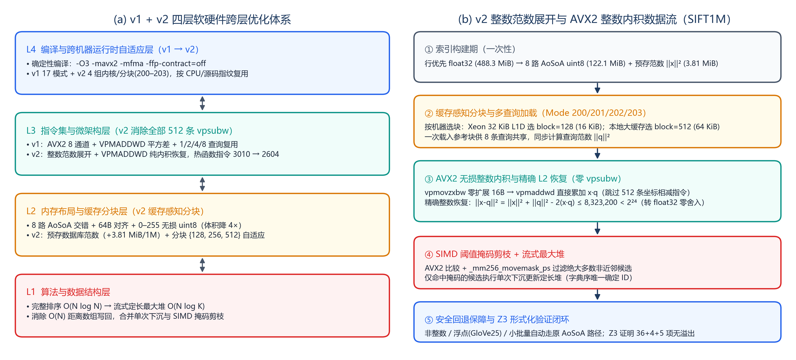
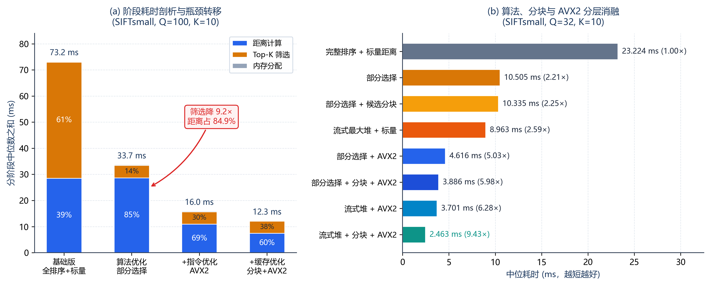
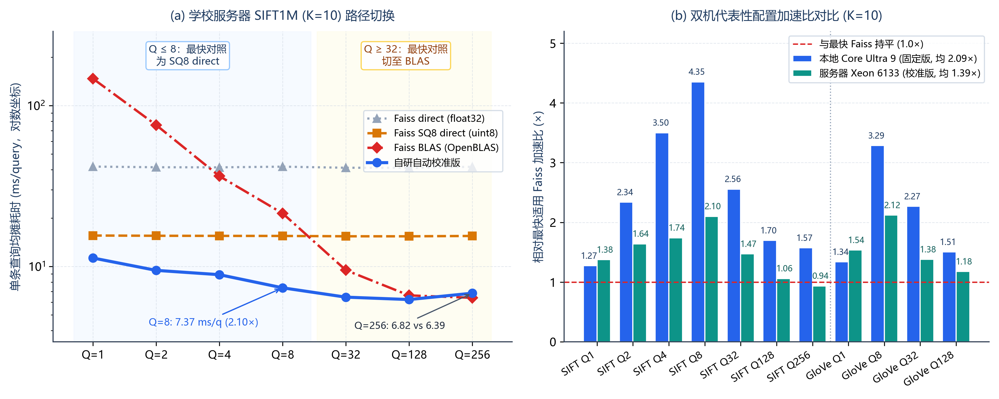
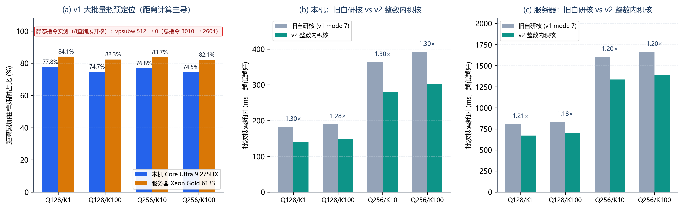
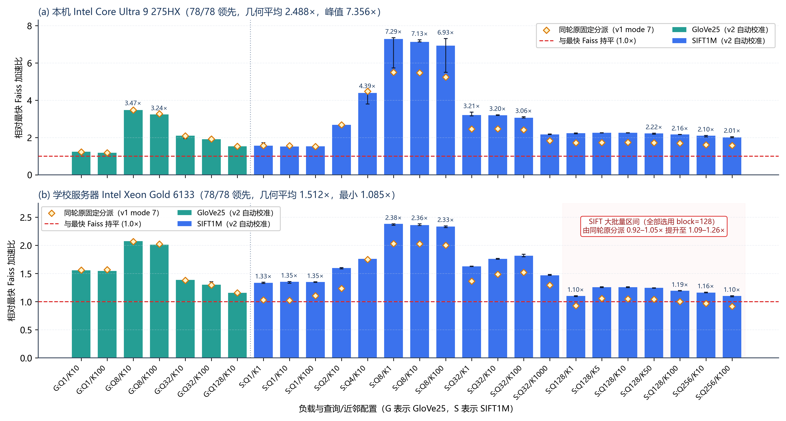
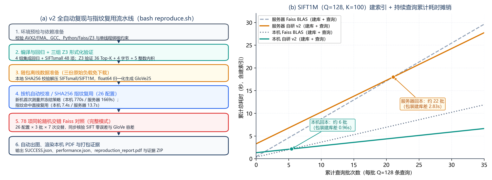

# 面向 CPU 精确向量检索的跨层优化与跨机器自动校准

姓名：赵信喆　学号：51295903131

课程：软件系统优化　版本：v2 课程提交版　日期：2026年11月27日

## 摘要

精确最近邻检索（Exact kNN）要求在百万级常驻内存向量库上计算批量查询与全部参考向量的平方 L2 距离并返回前 K 个近邻，广泛用于中小规模高精度检索、近似索引的倒排桶扫描与精排（Rerank）以及评测真值生成。针对该负载在通用 CPU 上同时面临的 Top-K 筛选开销、数据表示与缓存局部性瓶颈、指令级计算压力以及跨微架构性能分化问题，本项目以 SIFT1M、GloVe25 和 SIFTsmall 为真实负载，在个人电脑 WSL 与学校 Linux 服务器两台架构差异显著的机器上，完成了两轮完整的“测量 → 分析 → 跨层优化 → 验证与复现”闭环。

第一阶段（v1）剖析初始全排序实现（SIFTsmall，Q=100，K=10）发现，Top-K 筛选占分阶段中位数之和的 60.8%，改为部分选择后筛选耗时下降 9.2 倍，瓶颈随即转移至距离计算（占 84.9%）。据此构建了覆盖**算法与数据结构层、内存与缓存层、指令集与微架构层、编译与运行时自适应层**的四层协同方案：采用流式定长最大堆消除全量距离数组；设计 8 路 AoSoA 交错布局、64 字节对齐、候选分块与 0–255 整数无损 `uint8` 表示（单份数据体积降低 4 倍）；结合 AVX2 `VPMADDWD`、多查询寄存器复用与固定维度展开实现高吞吐内核；并针对跨机器性能分化引入基于 CPU 与源码 SHA256 指纹的本机自动校准。v1 在本地 Core Ultra 9 275HX 取得 78/78 领先（几何平均 2.086×），在学校服务器 Xeon Gold 6133 上将领先项由固定版 57/78 提升至 67/78（几何平均 1.393×），但在 4 个大批量配置（Q=128/256）上仍略慢于固定 Haswell 路径的 OpenBLAS GEMM（0.883–0.99×）。

第二阶段（v2）对大批量落后配置重新展开细粒度剖析与反汇编核查，发现距离累加占抽样时间的 **74.5%–77.9%（本机）**与 **81.9%–84.1%（服务器）**，且 8 查询展开核内层循环包含多达 512 条 `vpsubw` 坐标相减指令。v2 提出**预存数据库整数范数 + AVX2 无损整数内积恢复精确 L2 距离**（仅增加 3.81 MiB/百万向量），在静态层面消除了热循环全部 **512 条 `vpsubw` 指令**（热函数静态指令由 3,010 降至 2,604），并将候选分块 `{128, 256, 512}` 纳入按机器自动校准（`mode 200-203`）。最终在两台机器上重新完成 26 配置 × 3 批查询的 78 项同轮 Faiss 对照，**两机均取得 78/78 全面领先且正确性 78/78 全部通过**：本机 Core Ultra 9 275HX 几何平均加速比达 **2.488×**（SIFT1M 2.738×，峰值 **7.356×**；GloVe25 1.919×）；学校服务器 Xeon Gold 6133 几何平均加速比达 **1.512×**（最小 **1.085×**），所有大批量配置凭借自适应选择 `block=128`（16 KiB 契合 32 KiB L1D）全部转为领先。提交材料配套提供完整原始负载、Z3 形式化验证（36 项有界 Top-K + 4 项字节算术 + 5 项 v2 整数内积证明与双反例证伪）、AI 辅助闭环记录与一键复现入口（`bash reproduce.sh`）。

## 1. 研究问题、应用意义与相关工作

### 1.1 研究问题与真实应用场景

本项目研究常驻内存向量库上的批量精确最近邻检索（Exact kNN Search）。给定包含 N 条 D 维参考向量的数据库 X 与包含 Q 条查询向量的批次 Q_batch，程序需精确计算所有参考向量与每条查询之间的平方 L2 距离，并为每条查询返回距离最小的 K 个候选及其编号（距离相同时按 ID 升序确定唯一全序）。下文统一用 N、D、Q、K 分别表示参考库规模、向量维度、单次调用查询数与返回近邻数。

尽管超大规模检索系统常借助 HNSW、IVF-PQ 等近似最近邻（ANN）索引减少计算量，但**精确向量检索在真实生产与科研系统中仍具有不可替代的基础地位**：（1）百万级以下向量库在低延迟或零召回损失约束下（如高精度图像局部特征匹配、敏感风控与高精度 RAG 检索）直接执行精确扫描；（2）在 IVF-Flat 倒排索引的桶内扫描及多阶段检索的候选精排（Rerank）环节，底层算子本质上仍是批量精确 L2 计算与 Top-K 维护；（3）近似索引算法评测所需的基准真值（Ground Truth）亦依赖高效精确检索生成。

| 数据集 | 全库规模 N | 维度 D | 负载来源与预处理口径 |
|---|---|---|---|
| SIFTsmall | 10,000 | 128 | SIFT 标准子集；专用于阶段耗时剖析、算法/分块/SIMD 分层消融与 48 项回归 |
| SIFT1M | 1,000,000 | 128 | 真实图像局部描述子；实际坐标均为 0–255 整数，输入文件保持原始 float32 格式不变 |
| GloVe25 | 1,183,514 | 25 | ANN-Benchmarks 词向量切分；float64 求范数归一化后存为 float32，并重算精确 L2 真值 |

三份原始数据归档均随提交包提供 [3][4]，数据来源、文件大小与 SHA256 清单见包内 `DATA_SOURCES.md` 与 `DATA_MANIFEST.json`。评价指标涵盖每批查询中位耗时（ms）、折算查询吞吐率（Q / 批次耗时，QPS）、建索引耗时（ms/s）、首次校准与缓存复用时间以及索引载荷与进程峰值内存（MiB）。所有主性能查询计时均严格覆盖完整公开 Python 调用链路——包括输入检查、查询编码、距离计算、Top-K 筛选与结果输出分配；数据准备、建索引、校准与真值校验单独记录并分开评估。

### 1.2 相关工作与工业级对照基准

工业界主流向量检索库 Faiss [1] 针对精确平方 L2 检索提供了多条高度优化的执行路径，代表了当前 CPU 精确检索的两类经典范式：

1. **默认调度入口（`faiss_flat`）**：`IndexFlatL2` 的默认搜索入口，依据批量大小 Q 与内部阈值自动在直接计算路径和 BLAS 路径之间切换，作为常规使用方式对照。
2. **强制直接计算路径（`faiss_direct`）**：绕过 BLAS，直接遍历 float32 参考向量并利用 SIMD 累加坐标差平方，即时维护结果堆，适合极小批量（如 Q=1）场景。
3. **强制矩阵乘法路径（`faiss_blas`）**：利用恒等式 ||x - q||^2 = ||x||^2 + ||q||^2 - 2 x·q，将批量距离计算转化为通用矩阵乘法（OpenBLAS SGEMM），在大批量下依靠高算术强度与底层汇编微核获得高吞吐，但在小批量下存在明显的范数与矩阵封装开销。
4. **无损字节直接路径（`faiss_sq8_direct`）**：对于坐标天然为 0–255 整数的 SIFT 数据，Faiss 的 `QT_8bit_direct` [2] 直接以单字节保存坐标而无量化舍入，将单份参考库表示压缩至 float32 的 1/4。

下表汇总了本文自研路径（含 v1 直接平方差核与 v2 整数内积核）与上述 Faiss 精确/无损路径的核心差异。需要说明的是，v2 与 `faiss_blas` 虽在数学上均利用范数加内积恒等式，但 v2 的 AVX2 整数内积计算、无损字节交错表示、查询分组、阈值掩码、流式堆与自适应调度全部由本项目独立实现，**自研路径不调用任何 Faiss 或 BLAS 函数**。

| 检索方法 | 距离计算方式 | 批量查询与缓存处理 | SIFT1M 索引载荷 | 适用数据条件 |
|---|---|---|---|---|
| **自研 v1（基础跨层）** | 8 路 AoSoA 直接平方差（整数 AVX2 `VPMADDWD`，浮点 FMA） | 固定 256 候选块内 1/2/4/8 查询复用 + 流式最大堆 + 17 模式选核 | 610.4 MiB（浮点 488.3 + 字节 122.1 双布局） | 任意有限 float32；0–255 整数且 D <= 258 启用无损字节路径 |
| **自研 v2（本文最终版）** | 在 v1 基础上新增预存整数范数 + AVX2 整数内积恢复（消除 `vpsubw`） | 按机器自适应候选分块 `{128, 256, 512}` + 4/8 查询分组（`mode 200-203`） | 614.2 MiB（较 v1 增 3.81 MiB 整数范数数组） | 整数条件、D=128 且 Q >= 8 参与选核；其余自动走原路径 |
| **Faiss direct** | 行优先 float32 SIMD 直接平方差 | 逐查询或小步长遍历，跨查询参考块复用有限 | 488.3 MiB | 任意 float32 |
| **Faiss BLAS** | 范数展开 + OpenBLAS SGEMM | 整批矩阵乘（高算术强度）+ 距离矩阵 Top-K 筛选 | 488.3 MiB | 任意 float32（大批量优势显著） |
| **Faiss SQ8 direct** | 行优先单字节解码后直接 L2 计算 | 逐查询扫描字节库，缺乏跨查询参考块复用 | 122.1 MiB | 0–255 整数输入（该条件下精确无损） |

为保证对照严格公平，本项目在两机全部 78 项主实验中同时测量 `faiss_flat`、`faiss_direct`、`faiss_blas` 以及（在 SIFT 上）`faiss_sq8_direct`，**每项测试均以该配置下耗时最短的适用 Faiss 路径作为强基准**。原有普通实现用于逐层消融解释各层贡献，Faiss 用于评估最终实现的工业竞争力。

## 2. 第一阶段（v1）：初始瓶颈剖析与四层跨层优化体系

### 2.1 初始基线剖析与瓶颈转移

遵循“先测量剖析、再定向优化”的系统方法论，我们首先在 SIFTsmall（N=10,000, D=128, Q=100, K=10，随机交替重复 21 次，原始记录位于 `baseline/results/perf_20261109T090707225322Z/workload_stat.json`）上对基础程序进行分阶段插桩剖析，分别计算内存分配、距离计算与 Top-K 筛选三个阶段的中位数（总耗时口径为分阶段中位数之和；同一轮数据的单次总耗时中位数分别为 73.24、33.95、15.99、12.29 ms，两者差值均小于 0.21 ms，见第 5.1 节图 2(a)）：

- **第一阶段瓶颈（Top-K 筛选主导）**：原始基线先计算全量 N 个距离再执行完整排序，分阶段中位数之和为 73.20 ms，其中筛选排序高达 **44.51 ms（占比 60.8%）**，超过距离计算的 28.48 ms（38.9%）。在全排序未消除前，仅优化距离内核的整体收益会受阿姆达尔定律制约。
- **瓶颈转移（距离计算主导）**：将完整排序替换为部分选择后，筛选耗时由 44.51 ms 降至 **4.82 ms（下降 9.2×）**，总耗时减半至 33.74 ms；此时**距离计算占比上升至 84.9%（28.64 ms）**，成为主要瓶颈。
- **访存与计算协同突破**：随后引入 AVX2 向量化与 256 候选缓存分块，距离计算耗时由 28.64 ms 连续压缩至 10.95 ms 与 **7.42 ms（下降 3.86×）**，分阶段中位数之和降至 12.30 ms。进一步用流式最大堆替代全量距离数组（消除 O(N) 写回与二次扫描），最终在百万级全库上结合无损字节表示、多查询寄存器复用与 v2 整数内积展开持续压低延迟。

### 2.2 四层软硬件跨层优化体系

结合第一阶段的基础跨层设计与第二阶段的指令级/缓存级升级，本项目最终形成了覆盖**四个软硬件不同层次**的完整优化体系，各层核心手段与演进关系如下表及图 1 所示：

| 优化层次 | v1 基础优化手段 | v2 升级优化手段 | 解决的系统瓶颈 |
|---|---|---|---|
| **L1 算法与数据结构层** | 完整排序 O(N log N) → 流式定长最大堆 O(N log K)；合并单次下沉；距离/ID 字典序全序 | 保留流式堆与 SIMD 阈值掩码，确保与新距离内核零拷贝衔接 | 消除全排序开销与 O(N) 距离数组写回，筛选耗时下降近一个数量级 |
| **L2 内存与缓存体系层** | 8 路 AoSoA 交错布局；64 字节对齐；固定 256 候选分块；0–255 无损 `uint8` 表示（体积降 4×） | 建索引期预存数据库整数范数（+3.81 MiB/1M）；扩展候选分块 `{128, 256, 512}` 适配不同 L1D 容量 | 消除跨步访存并压低带宽需求；v2 进一步解决 Xeon 32 KiB L1D 下的块容量匹配问题 |
| **L3 指令集与微架构层** | AVX2 8 通道并行；`VPMADDWD` 无损平方差累加；1/2/4/8 查询寄存器复用；128/25 维展开 | 以范数展开 + `VPMADDWD` 整数内积恢复距离，消除热循环全部 **512 条 `vpsubw`**（总指令 3,010 → 2,604） | 释放单核 SIMD 吞吐并在距离累加占 75%–84% 的大批量热点上直接削减核心算术指令 |
| **L4 编译与运行时自适应层** | `-O3 -mavx2 -mfma -ffp-contract=off` 确定性编译；17 候选模式自动校准 + SHA256 指纹复用 | 将 4 组整数内积与分块组合（`mode 200-203`）接入统一校准框架，双批训练 1.03× 门槛 + 独立验证 | 消除跨代际 CPU 静态启发式次优问题，在双机不同缓存拓扑下自动收敛至最优核与分块 |

图中 (a) 为项目完整的四层软硬件跨层优化演进架构（涵盖 v1 基础层与 v2 指令/分块升级），(b) 为 v2 在 SIFT1M 上从行优先 float32 构建 8 路 AoSoA 无损字节与预存范数、经零 `vpsubw` AVX2 内积与流式最大堆完成检索的完整数据流（静态指令与载荷数据引自 `static_instruction_counts.json` 与 `setup_v1/summary.json`）。

### 2.3 算法层：从完整排序到流式定长最大堆

基础实现先为每条查询分配长度为 N 的距离数组，算完后完整排序取前 K 项。实际检索仅需前 K 个结果（通常 K << N）。第一步改用部分选择（`nth_element` + 局部排序），将选择复杂度降至线性期望；第二步升级为**容量固定为 K 的流式最大堆**，边扫描候选块边维护当前最优 K 个结果。堆顶始终保存当前第 K 小的距离阈值，只有严格更优的候选才触发更新；同时将堆顶替换与重新建堆合并为**单次向下调整（sift-down）**，既消除 O(N) 距离缓冲的内存分配与缓存污染，又降低维护常数。当两个候选距离完全相等时，统一按 ID 升序排列，确保跨平台与跨实现结果严格一致。

### 2.4 内存与缓存层：8 路 AoSoA、候选分块与无损字节表示

普通行优先存储将单条向量的 D 个维度连续排列，执行“单条查询对比多条候选”的 SIMD 计算时需频繁执行昂贵的跨步收集（gather）或水平规约。为此设计了 **8 路 AoSoA（Array of Structures of Arrays）交错布局**：每 8 条候选向量的同一维度（整数路径下为相邻两维）紧邻存放，块起始地址按 **64 字节缓存行对齐**。

计算时，程序将参考库按工作块切分（v1 固定 256 候选，v2 扩展为 `{128, 256, 512}` 按机选择），在外层将 1/2/4/8 条查询打包联合处理：每个参考块驻留于缓存期间被组内全部查询连续复用。对于 SIFT 类整数特征，虽然磁盘与调用接口仍采用 float32，但坐标实为 0–255 整数。索引构建与查询入口逐项校验该性质（不依赖数据集名称硬编码）；满足条件时以无损 `uint8` 字节格式保存计算载荷，使百万向量的单份数据表示体积由 488.3 MiB 降至 **122.1 MiB（降低 4 倍）**；若输入包含非整数、超范围坐标或维度超出安全上界，则自动回退至对齐浮点直接平方差路径。

### 2.5 指令集与微架构层：AVX2、`VPMADDWD` 与固定维度展开

在 v1 无损整数内核中，AVX2 的 8 个 32 位通道同时服务 8 个候选向量，每步迭代处理相邻两维（奇数维末尾补零）：加载 16 字节并经 `vpmovzxbw` 零扩展为 16 个有符号 16 位整数，经 `vpsubw` 与广播后的查询坐标求差，再利用单条 **`vpmaddwd`** 完成 8 组相邻两维平方和并直接累加至 32 位整型寄存器。因为坐标差属于 [-255, 255]，两维平方和不超过 130,050；当 D <= 258 时，总平方和不超过 258 × 255^2 = 16,776,450 < 2^24 = 16,777,216，在有符号 `int32` 内不会溢出，且转换为 IEEE-754 `float32`（24 位尾数）时**严格无精度损失**。

距离算出后，利用 AVX2 比较与 `_mm256_movemask_ps` 生成 8 位掩码与每条查询的堆顶阈值比对——扫描中绝大多数候选掩码为 0，直接跳过标量堆操作。针对常见的 128 维与 25 维负载，还提供编译期固定维度展开内核以消减循环分支与地址步进指令；大批量下在单线程内联合展开 2、4 或 8 条查询的累加器实现寄存器级复用。

### 2.6 编译与运行时自适应层：固定分派与跨机自动校准

所有 C++ 内核统一使用 GCC `-std=c++17 -O3 -mavx2 -mfma -ffp-contract=off` 编译（关闭浮点融合收缩以保障跨路径数值一致性）。早期固定版（`mode 7` / `direct_auto`）依据数据类型、维度与 Q 静态分派内核（如 128 维整数在 Q=1 选展开核 `mode 110`，Q >= 5 选八查询展开核 `mode 113`）。

跨机器迁移实验表明静态启发式规则无法通用于不同微架构（如 Xeon Gold 6133 上 Q=1 展开核反而慢于紧凑循环核）。因此系统引入了 **L4 运行时本机自动校准层**：在目标机器上使用独立训练查询实测全部适用候选，仅当候选在两批训练查询上相对原固定分派均达到 **1.03×** 门槛时才择优替换，随后冻结选择并用独立验证查询检验。校准结果连同 CPU 型号、缓存拓扑、绑定逻辑核、编译器版本、源码与库文件 SHA256 指纹持久化保存；后续运行命中指纹直接复用，环境或代码变更则重新校准，缺失、损坏或身份不匹配时安全回退至 `mode 7`，且公开搜索接口本身不会隐式触发校准。

## 3. 第二阶段（v2）：大批量瓶颈再剖析、整数内积内核与分块自适应

### 3.1 大批量热点定位与静态指令级瓶颈分析

在 v1 自动校准版中，学校服务器 Xeon Gold 6133 已将 78 项对照领先数提升至 67/78，但 SIFT1M 的 4 个大批量配置（`Q128/K1`、`Q128/K100`、`Q256/K10`、`Q256/K100`）仍略慢于固定 Haswell 路径的 OpenBLAS SGEMM（0.883–0.99×）。为彻底攻克大批量瓶颈，v2 首先遵循“再测量 → 再分析”原则，对上述四个配置执行独立分段抽样剖析（采样周期 32/128/512，插桩额外开销控制在 2.7%–5.1%，原始数据见 `experiments/v2/evidence/local-20261127/local_profile_v1/summary.csv` 与 `server-20261127/server_profile_v1/summary.csv`）：

- **距离累加仍是绝对热点**：在采样周期 128 下，本机四个配置的距离累加占抽样时间的 **74.5%–77.8%**（全周期 74.5%–77.9%），学校服务器高达 **82.1%–84.1%**（全周期 81.9%–84.1%），而归约、阈值掩码筛选与堆维护合计仅占 15.9%–25.5%。单靠调整筛选或分块无法弥补两位数百分比的计算差距。
- **反汇编指令级根因**：进一步提取编译后目标函数的静态指令统计（`experiments/v2/evidence/local-20261127/static_instruction_counts.json`）发现，v1 的 8 查询 128 维展开核 `byte128_search<8, 1>` 共含 **3,010 条**静态指令，其中内层热循环仅坐标相减 **`vpsubw` 就高达 512 条**，与 `vpmaddwd`（512 条）、`vpaddd`（505 条）及 `vpbroadcastd`（514 条）几乎一比一并列，占据了宝贵的向量算术端口带宽。

### 3.2 预存整数范数与 AVX2 无损整数内积恢复

针对内层循环 512 条 `vpsubw` 指令，v2 引入平方 L2 距离的整数代数恒等式重构计算内核：

**||x - q||^2 = ||x||^2 + ||q||^2 - 2 × (x · q)**

具体设计如下：
1. **一次性预存数据库范数**：建索引时为每条数据库向量计算一次精确整型平方范数 ||x||^2 并保存为 `int32`（每百万条 128 维向量仅增加 **4,000,000 字节 ≈ 3.81 MiB**）；查询向量平方范数 ||q||^2 在每次搜索入口对 Q 条查询各计算一次，开销可忽略。
2. **零 `vpsubw` 的 AVX2 整数内积微核**：在 8 路 AoSoA 字节块与 8 查询寄存器复用循环中，经 `vpmovzxbw` 零扩展 16 字节候选后，**不再执行 `vpsubw` 相减**，直接用 `vpmaddwd` 与广播查询坐标做相邻两维整数乘加累加内积 x·q；仅在 128 维归约完成后的循环外层，按上述恒等式一次恢复精确平方 L2 距离并转为 `float32` 送入掩码筛选与流式最大堆。
3. **严格精确无溢出边界**：当 D=128 且坐标属于 [0, 255] 时，单维乘积上界 65,025，两维乘加上界 130,050，整条向量的范数、内积与平方距离上界均为 **128 × 255^2 = 8,323,200**，远小于有符号 `int32` 上界（2^31 - 1）且严格小于 `float32` 精确整数表示上界（2^24 = 16,777,216），全程无任何溢出或浮点舍入误差（由第 6.2 节新增 5 项 Z3 证明保证）。

静态反汇编统计（`static_instruction_counts.json`）直接印证了指令级削减效果：

| 编译后核心函数（8 查询 128 维展开） | 总静态指令数 | `vpsubw`（相减） | `vpmaddwd`（乘加） | `vpaddd`（累加） | `vpbroadcastd` | `vpmovzxbw` |
|---|---:|---:|---:|---:|---:|---:|
| v1 `byte128_search<8, 1>` | 3,010 | **512** | 512 | 505 | 514 | 64 |
| v2 `dot128_search<8, 1>` | **2,604**（-13.5%） | **0**（-100%） | 512 | 524 | 515 | 64 |

在独立无插桩候选筛选阶段（冻结选择后用三批独立新查询随机交错确认，`confirmation.json`），新整数内积核相对旧自研核在四个大批量配置上稳定取得 **1.27–1.30×（本机）**与 **1.17–1.22×（服务器）**的纯内核提速（见第 5.3 节图 4）。

### 3.3 缓存感知候选分块扩展与跨机策略融合

在消除 `vpsubw` 显著提高算术吞吐后，参考向量块在 L1/L2 缓存中的驻留尺寸成为进一步释放跨机器潜力的关键杠杆。v2 在保留全部原有 17 个候选的基础上，新增 4 组整数内积与候选分块组合并接入 `autotune_v2` 统一校准框架：

- **`mode 200`**：8 查询分组 + **128 候选分块**（单块字节载荷 128 × 128 B = **16 KiB**）；
- **`mode 201`**：8 查询分组 + **256 候选分块**（单块字节载荷 **32 KiB**）；
- **`mode 202`**：8 查询分组 + **512 候选分块**（单块字节载荷 **64 KiB**）；
- **`mode 203`**：4 查询分组 + **256 候选分块**（单块字节载荷 **32 KiB**）。

新候选仅在数据库与查询均满足 0–255 整数条件、D=128 且 Q >= 8 时参与自动校准，其他负载（如连续浮点 GloVe25 或 Q < 8 小批量）自动沿用已有路径。校准使用两批训练查询，要求候选在两批中均比原 `mode 7` 快至少 3%（1.03× 门槛）方具备入选资格，随后冻结选择并在两批独立验证查询上核验，保证策略不向确认集过拟合。

## 4. 实验设计与评测协议

为系统验证优化方案的绝对性能、迭代演进与跨机可移植性，全部实验在两台硬件配置差异显著的 x86-64 机器上按统一口径执行（详细环境与编译指纹随归档保存）：

| 环境维度 | 本机（开发与双版全量实测） | 学校服务器（跨机迁移与双版全量实测） |
|---|---|---|
| CPU 型号 | Intel Core Ultra 9 275HX（24 核） | Intel Xeon Gold 6133 @ 2.50 GHz |
| 实测缓存拓扑 | `lscpu` 汇总：L1d 1.1 MiB / L1i 1.5 MiB / L2 72 MiB（24 实例），L3 36 MiB | `sysfs` 单核：L1d 32 KiB / L1i 32 KiB / L2 1 MiB / L3 27.5 MiB |
| 操作系统与内核 | Windows WSL2 Ubuntu 22.04（`Linux-6.18.33.2-microsoft-standard-WSL2`） | 原生 Ubuntu 22.04（`Linux 5.19.0-32-generic`） |
| 绑定逻辑核与线程 | 逻辑 CPU 0；自研、Faiss、OpenBLAS 均为单线程 | 逻辑 CPU 19；自研、Faiss、OpenBLAS 均为单线程 |
| 编译器与选项 | GCC 11.4.0，`-std=c++17 -O3 -mavx2 -mfma -ffp-contract=off` | 同左侧编译器与确定性编译选项 |
| 关键软件与 BLAS | Python 3.10.12、NumPy 2.2.6、Faiss CPU 1.15.1、`OPENBLAS_CORETYPE=Haswell` | 同左侧软件版本与固定 Haswell BLAS 路径 |

关于 `OPENBLAS_CORETYPE=Haswell`：两台机器与默认复现脚本均显式固定该变量，以确保 OpenBLAS 在两代 CPU 上走相同的 AVX2/FMA 路径，避免因自动探测内核不同而引入混淆变量；该设置保证双机横向严格可比，同时界定了 `faiss_blas` 对照对应固定 Haswell 路径的表现。

主实验覆盖 **26 个配置**（SIFT1M 19 项 + GloVe25 7 项），每个配置测试 **3 批**独立查询，构成 **78 项**完整对照。每项测试先校验正确性并预热，再在同一进程内对自研 v2、同轮原固定分派（`mode 7`）及全部适用 Faiss 路径执行 **7 次随机交错测量**，取各方法耗时中位数作为该批成绩。校准训练查询、校准验证查询与正式 78 项比较查询严格互不重叠，正式测试前冻结源码与所选配置。此外在 SIFTsmall 上另行完成 48 项完整负载功能回归。

加速比统一定义为 **“最快适用 Faiss 路径中位耗时 / 自研程序中位耗时”**（大于 1.0× 表示自研领先）。下文表格中“耗时”为三批中位耗时的中位数，“加速比范围”为三批各自加速比的最小值至最大值。

## 5. 分层消融、跨机演进与 v2 双机完整实验结果

### 5.1 逐层消融与组件贡献验证（v1 基础验证）

为量化第一阶段每一层改动的独立贡献，我们先在 SIFTsmall（N=10,000, D=128, Q=32, K=10，编译器自动向量化开启，重复 7 次，原始记录位于 `baseline/results/goal_ablation_20261124T054947270218Z/internal_summary.csv`）上对比算法、分块与 AVX2 的叠加效应（图 2），再在百万级真实全库上剥离无损字节表示与固定维度展开的收益。

图中 (a) 为本地 Core Ultra 9 275HX 上 SIFTsmall（Q=100, K=10, 21 次重复）的分阶段中位数之和剖析，(b) 为同机 SIFTsmall（Q=32, K=10, 7 次重复）8 种内部实现组合相对完整排序基线的逐步加速阶梯。

| 内部实现组合（SIFTsmall, Q=32, K=10） | 所属优化层次 | 中位耗时 ms | 相对全排序加速 |
|---|---|---:|---:|
| 完整排序 + 标量距离 | 基线 | 23.224 | 1.00× |
| 部分选择 | L1 算法 | 10.505 | 2.21× |
| 部分选择 + 候选分块 | L1 + L2 缓存 | 10.335 | 2.25× |
| 流式最大堆 + 标量距离 | L1 算法（深度） | 8.963 | 2.59× |
| 部分选择 + AVX2 | L1 + L3 SIMD | 4.616 | 5.03× |
| 部分选择 + 分块 + AVX2 | L1 + L2 + L3 | 3.886 | 5.98× |
| 流式堆 + AVX2 | L1 + L3 | 3.701 | 6.28× |
| **流式堆 + 分块 + AVX2** | **L1 + L2 + L3 协同** | **2.463** | **9.43×** |

实验呈现出清晰的**跨层协同放大效应**：在标量部分选择上单独加分块仅提速 1.6%（10.505 → 10.335 ms），因彼时受标量计算限制；而引入 AVX2 大幅压低计算时间后，缓存局部性成为关键瓶颈，加入分块使流式堆路径从 3.701 ms 降至 2.463 ms（额外提速 **1.50×**），整体相对基础全排序加速 **9.43×**。

在百万级全库（保持 64 字节对齐与 AoSoA）上的组件消融同样验证了各层独立收益：

| 真实全库配置（本机） | 前版内核（浮点/原堆）ms | 中间改动 ms | v1 展开核 ms | 前版 / v1 |
|---|---:|---:|---:|---:|
| SIFT1M Q=1, K=100 | 18.924 | 6.105（通用字节核） | 5.316（+128 维展开） | **3.56×** |
| SIFT1M Q=128, K=100 | 317.302 | 254.088（通用字节核） | 190.868（+128 维展开） | **1.66×** |
| GloVe25 Q=128, K=10 | 117.978 | 116.205（单次下沉） | 80.514（+25 维展开） | **1.47×** |

### 5.2 跨机迁移分化、Faiss 路径切换与两代版本演进（v1 → v2）

将本地 78/78 领先的 v1 固定版迁移至学校服务器 Xeon Gold 6133 时，暴露出两类关键系统现象（图 3）：

图中 (a) 为学校服务器 Xeon Gold 6133 上 SIFT1M（K=10）单条查询均摊耗时随批量 Q 的变化，清晰展示 `faiss_blas` 在 Q=8 与 Q=32 之间反超 `faiss_sq8_direct`；(b) 为 v1 阶段双机代表性配置（K=10）相对最快 Faiss 的加速比分化，直观揭示了引入自动校准与 v2 大批量内核的必要性。

1. **小批量展开核与紧凑核的跨机分化（Q=1/2）**：在本地 Core Ultra 9 275HX 上，128 维展开核快于通用字节循环核 1.15×；但在 Xeon Gold 6133（单核 L1I 仅 32 KiB）上，展开核 `mode 110` 在 Q=1 耗时 15.62–15.73 ms，略慢于 `faiss_sq8_direct`（15.55–15.63 ms）。自动校准在同一台服务器上将其改选为紧凑循环核 `mode 100`，使 Q=1 降至 11.23–11.29 ms（v2 同轮进一步稳定在 10.90–11.34 ms，提速约 **1.22–1.39×**），由略微落后转为稳定领先。
2. **批量规模驱动的 Faiss 路径切换（Q=1–256）**：如图 3(a) 所示，`faiss_direct` 与 `faiss_sq8_direct` 的单查询均摊耗时几乎不随 Q 下降；而 `faiss_blas` 随批量增大摊薄 GEMM 开销，在 Q=8 与 Q=32 之间反超 `faiss_sq8_direct` 成为大批量最强基线。这正是 v1 仅依靠直接平方差核在服务器 Q=128/256 落后于 BLAS、而 v2 引入零 `vpsubw` 整数内积核后实现全面反超的直接原因。

下表汇总了项目从 v1 固定版、v1 自动校准版到 v2 整数内积自动校准版的完整演进轨迹（各行均对应各自归档同轮实测）：

| 机器与演进版本 | 领先批次数 | 三批全领先配置数 | 总体几何平均加速比 | 加速比范围 | 关键改进效果 |
|---|---:|---:|---:|---:|---|
| 本机 Core Ultra 9 275HX，v1 固定版 | 78 / 78 | 26 / 26 | 2.086× | 1.210–4.600× | 四层基础优化全量领先 |
| **本机 Core Ultra 9 275HX，v2 自动校准版** | **78 / 78** | **26 / 26** | **2.488×** | **1.115–7.356×** | 整数内积 + 分块自适应，SIFT 峰值跃升至 7.356× |
| 服务器 Xeon Gold 6133，v1 固定版（早期） | 57 / 78 | 16 / 26 | 1.307× | — | 跨机迁移暴露 Q=1 与大批量分化 |
| 服务器 Xeon Gold 6133，v1 自动校准版 | 67 / 78 | 22 / 26 | 1.393× | 0.883–2.130× | 自动改选 `mode 100` 解决 Q=1/2；Q=4 留有 3.9% 噪声 |
| **服务器 Xeon Gold 6133，v2 自动校准版** | **78 / 78** | **26 / 26** | **1.512×** | **1.085–2.384×** | 消除 512 条 `vpsubw` + 选 `block=128`，大批量全反超，Q=4 回归 `mode 7` |

### 5.3 v2 大批量核心内核收益与双机 78 项全景

图 4 展示了 v2 针对四个大批量重点配置的瓶颈抽样占比、静态指令削减实锤以及双机新旧自研内核的独立确认对比。在候选确认阶段，整数内积核相对旧自研核在本机实现 **1.27–1.30×** 加速，在学校服务器实现 **1.17–1.22×** 加速。

图中 (a) 为采样周期 128 下双机 v1 距离累加耗时占比及 8 查询展开核静态指令变化，(b)/(c) 为候选确认阶段双机四个大批量配置旧自研核（`v1 mode 7`）与 v2 整数内积核的批次中位耗时对比（来源 `local_profile_v1`、`server_profile_v1`、`static_instruction_counts.json` 与双机 `confirmation.json`）。

将新内核与分块自适应正式合入 `autotune_v2` 后，两台机器均独立完成 26 配置校准、冻结与 78 项同轮 Faiss 对照，总体汇总与分数据集表现如下表及图 5 所示：

| 机器 | 正确性 | 领先项数 | 总体几何平均加速比 | 最小加速比 | 最大加速比 |
|---|---:|---:|---:|---:|---:|
| 本机 Core Ultra 9 275HX | 78 / 78 | **78 / 78** | **2.488×** | 1.115× | **7.356×** |
| 学校服务器 Xeon Gold 6133 | 78 / 78 | **78 / 78** | **1.512×** | **1.085×** | **2.384×** |

| 机器 | 负载 | 领先项数 | 几何平均加速比 | 加速比范围 |
|---|---|---:|---:|---:|
| 本机 Core Ultra 9 275HX | GloVe25（浮点） | 21 / 21 | 1.919× | 1.115–3.525× |
| 本机 Core Ultra 9 275HX | SIFT1M（无损整数） | 57 / 57 | **2.738×** | 1.488–7.356× |
| 学校服务器 Xeon Gold 6133 | GloVe25（浮点） | 21 / 21 | 1.545× | 1.147–2.087× |
| 学校服务器 Xeon Gold 6133 | SIFT1M（无损整数） | 57 / 57 | **1.500×** | 1.085–2.384× |

图中每根柱为三批相对最快适用 Faiss 加速比的中位数，误差线为三批极值范围，琥珀色菱形为同一测试轮次中原固定分派（`v1 mode 7`）的加速比，虚线为 1.0× 基准线（来源双机 `integrated-*-20261127/run/faiss78/summary.csv`）。

重点观察四个大批量配置在两台机器上的实测结果与自动分块选择：

| 机器 | Q/K | 自研 v2 ms | 同轮原分派 ms | 最快 Faiss ms | 三批加速比范围 | 自动选定模式/分块 |
|---|---|---:|---:|---:|---:|---|
| 本机 | 128/1 | 143.44 | 185.59 | 319.55 | 2.196–2.244× | 200 / 128 |
| 本机 | 128/100 | 151.91 | 194.32 | 328.81 | 2.150–2.165× | 202 / 512 |
| 本机 | 256/10 | 285.12 | 371.22 | 599.52 | 2.032–2.107× | 202 / 512 |
| 本机 | 256/100 | 300.23 | 383.60 | 603.17 | 1.991–2.040× | 202 / 512 |
| 服务器 | 128/1 | 668.86 | 798.71 | 736.91 | 1.090–1.105× | **200 / 128** |
| 服务器 | 128/100 | 699.02 | 832.54 | 833.43 | 1.189–1.195× | **200 / 128** |
| 服务器 | 256/10 | 1343.78 | 1609.87 | 1556.11 | 1.157–1.167× | **200 / 128** |
| 服务器 | 256/100 | 1388.26 | 1662.84 | 1524.93 | 1.085–1.104× | **200 / 128** |

**跨机器分块选择分析**：完整 26 配置记录显示，学校服务器 Xeon Gold 6133 上，全部 7 个 Q >= 128 的 SIFT1M 配置均选择了 `mode 200 / block=128`；本机 Core Ultra 9 275HX 上，大批量配置多数选择 `mode 202 / block=512`。128 分块的字节参考块占 16 KiB，512 分块占 64 KiB。较小分块缩小单块工作集，较大分块减少块切换次数，两者对应不同的缓存与循环开销取舍。因此程序保留多种分块，由目标机器上的实测结果决定选择。上述实验直接验证的是分块选择及其性能收益，缓存驻留与冲突行为属于机理分析。

### 5.4 双机全部 26 配置同轮对比明细

下两表给出本机与学校服务器 v2 正式同轮比较的全部 26 个配置（所有配置均 3/3 批次通过正确性检查与性能领先；SIFT1M 在 Q <= 8 时最快 Faiss 均为 `SQ8 direct`，Q >= 32 时均为 `BLAS`；GloVe25 在 Q=1 时为 `direct/flat`，Q >= 8 时均为 `BLAS`）：

#### SIFT1M 双机完整 19 配置同轮对比（N=1,000,000, D=128）

| Q/K | 本机模式/块 | 本机 v2 / Faiss (ms) | 本机加速比 | 服务器模式/块 | 服务器 v2 / Faiss (ms) | 服务器加速比 |
|---|---|---:|---:|---|---:|---:|
| 1/1 | 7 / 256 | 5.93 / 9.16 | 1.544–1.713× | **100 / 256** | 11.04 / 14.71 | 1.324–1.344× |
| 1/10 | 7 / 256 | 5.87 / 9.03 | 1.488–1.538× | **100 / 256** | 10.90 / 14.62 | 1.326–1.356× |
| 1/100 | 7 / 256 | 5.81 / 8.91 | 1.527–1.554× | **100 / 256** | 11.34 / 15.26 | 1.341–1.352× |
| 2/10 | 7 / 256 | 6.57 / 17.34 | 2.600–2.683× | **100 / 256** | 18.83 / 30.03 | 1.582–1.602× |
| 4/10 | 7 / 256 | 7.83 / 34.39 | 3.796–4.435× | 7 / 256 | 34.06 / 59.96 | 1.757–1.761× |
| 8/1 | **201 / 256** | 9.39 / 68.72 | 5.734–7.356× | **202 / 512** | 50.84 / 120.29 | 2.358–2.384× |
| 8/10 | **202 / 512** | 9.44 / 67.80 | 7.130–7.244× | **202 / 512** | 51.19 / 120.59 | 2.352–2.380× |
| 8/100 | **202 / 512** | 9.94 / 68.69 | 5.500–7.311× | **200 / 128** | 51.97 / 121.01 | 2.317–2.347× |
| 32/1 | **201 / 256** | 35.73 / 114.20 | 3.157–3.363× | **200 / 128** | 178.46 / 289.88 | 1.624–1.629× |
| 32/10 | **202 / 512** | 35.95 / 115.00 | 3.188–3.218× | **201 / 256** | 179.63 / 316.36 | 1.751–1.767× |
| 32/100 | **202 / 512** | 38.03 / 116.42 | 3.047–3.111× | **200 / 128** | 178.72 / 326.48 | 1.798–1.840× |
| 32/1000 | **202 / 512** | 57.29 / 124.26 | 2.157–2.184× | **200 / 128** | 227.21 / 333.51 | 1.466–1.481× |
| 128/1 | **200 / 128** | 143.44 / 319.55 | 2.196–2.244× | **200 / 128** | 668.86 / 736.91 | 1.090–1.105× |
| 128/5 | **202 / 512** | 143.03 / 321.85 | 2.246–2.260× | **200 / 128** | 674.83 / 846.05 | 1.249–1.264× |
| 128/10 | **200 / 128** | 144.10 / 325.29 | 2.243–2.257× | **200 / 128** | 674.08 / 845.91 | 1.247–1.262× |
| 128/50 | **201 / 256** | 147.67 / 329.06 | 2.175–2.229× | **200 / 128** | 685.09 / 852.06 | 1.237–1.245× |
| 128/100 | **202 / 512** | 151.91 / 328.81 | 2.150–2.165× | **200 / 128** | 699.02 / 833.43 | 1.189–1.195× |
| 256/10 | **202 / 512** | 285.12 / 599.52 | 2.032–2.107× | **200 / 128** | 1343.78 / 1556.11 | 1.157–1.167× |
| 256/100 | **202 / 512** | 300.23 / 603.17 | 1.991–2.040× | **200 / 128** | 1388.26 / 1524.93 | 1.085–1.104× |

#### GloVe25 双机完整 7 配置同轮对比（N=1,183,514, D=25）

| Q/K | 本机模式/块 | 本机 v2 / Faiss (ms) | 本机加速比 | 服务器模式/块 | 服务器 v2 / Faiss (ms) | 服务器加速比 |
|---|---|---:|---:|---|---:|---:|
| 1/10 | 7 / 256 | 5.38 / 6.64 | 1.148–1.238× | 7 / 256 | 9.44 / 14.77 | 1.531–1.571× |
| 1/100 | 7 / 256 | 5.25 / 6.22 | 1.115–1.215× | 7 / 256 | 9.64 / 14.90 | 1.546–1.567× |
| 8/10 | 7 / 256 | 7.12 / 24.86 | 3.449–3.525× | 7 / 256 | 26.03 / 54.02 | 2.058–2.087× |
| 8/100 | 7 / 256 | 7.63 / 24.70 | 3.171–3.256× | 7 / 256 | 27.60 / 55.80 | 1.988–2.033× |
| 32/10 | 7 / 256 | 21.63 / 45.48 | 1.939–2.104× | 7 / 256 | 87.21 / 121.56 | 1.379–1.396× |
| 32/100 | 7 / 256 | 23.53 / 45.02 | 1.854–2.006× | 7 / 256 | 94.29 / 120.72 | 1.276–1.351× |
| 128/10 | 7 / 256 | 80.82 / 123.46 | 1.516–1.559× | 7 / 256 | 346.63 / 399.65 | 1.147–1.156× |

可以看到，即使在连续浮点数据集 GloVe25 上（自动沿用浮点 AoSoA 路径，未启用整数内积），自研系统在双机全部 7 个配置上依然稳定领先 Faiss 1.115–3.525×；而在 SIFT1M 上，v2 整数内积与分块自适应将本机 `Q=8` 加速比推升至 **7.356×**，并使学校服务器全部 19 个配置（包括原落后的 `128/1`、`128/100`、`256/10`、`256/100`）全部转为稳健领先，同时原 v1 服务器上存在轻微波动的 `Q=4/K=10` 在本轮也自然收敛至 `mode 7`（34.06 ms，领先 Faiss 1.76×）。

## 6. 正确性检验、Z3 形式化验证与成本摊销分析

### 6.1 数值与边界正确性检验

本项目建立了覆盖单元边界、集成策略与百万全库的多层次正确性防线：
- **百万全库精确核对**：SIFT1M 采用独立 `float64` 穷举参考答案并与官方近邻真值核对；两台机器全部 57 项 SIFT1M 测试中，返回 ID、返回距离与排名距离均实现**零误差精确一致**。GloVe25 设定返回距离相对容差 1e-5 / 绝对容差 1e-4、排名对应距离相对 1e-5 / 绝对 1e-6，双机全部 21 项 100% 通过（ID 召回率 1.0 且顺序完全一致；v1/v2 实测最大返回距离误差仅 1.63e-7，最大排名距离差 2.22e-16）。
- **边界与集成回归矩阵**：在保留原有 3,292 项回归（1,620 项分派一致性、1,176 项字节边界、448 项早期回归与 48 项浮点边界）的基础上，v2 在候选阶段两台机器各通过 **258 项**针对新内核的边界回归（覆盖尾部候补、重复向量、K=N、0 与 255 极值、浮点输入与其他维度安全回退）；在集成阶段两台机器各通过 **4 组**集成回归（搜索结果、配置身份校验、模式与分块匹配、损坏配置自动回退与非法输入拦截），另在 SIFTsmall 上完成 **48 项**完整负载回归，覆盖原分流与四个新模式，双机还各自通过 **52 个**独立校准验证批次。

### 6.2 Z3 形式化验证（36 + 4 + 5 项全通过与双反例证伪）

本项目采用 SMT 求解器 **Z3 4.8.12** [6] 对核心排序与无损整数算术性质实施符号形式化验证，并纳入一键复现流水线的强制准入门槛（任一项失败或超时即中止运行），全部 SMT-LIB2 脚本、求解器版本与日志随包归档：

| 验证套件 | 覆盖对象与规约数 | 核心验证性质 | 求解结果 | 变异反例证伪 |
|---|---|---|---|---|
| **有界 Top-K 抽象模型**（v1） | N ∈ [1, 8]、K ∈ [1, N] 共 **36 项** | 流式状态转移后第 r 项输出 y_r 必属输入集合，且输入中恰有 r 项严格小于 y_r（互异实数全序） | 36/36 `UNSAT` | 改为保留最大值 → `SAT` 并输出具体反例 |
| **无损字节平方差引理**（v1） | 0–255 整数、D <= 258 共 **4 项** | ① d_i ∈ [-255, 255]（`vpsubw` 无溢出）；② 两维平方和 <= 130,050（`vpmaddwd` 无溢出）；③ 总和 <= 16,776,450 < 2^24（`int32` 与 `float32` 精确无损）；④ 奇数维补零不变性 | 4/4 `UNSAT` | 同轮脚本完整性校验通过 |
| **整数范数与内积引理**（v2 新增） | 0–255 整数、D=128 共 **5 项** | ① `integer_identity` 恒等式精确等价；② `product_bound` 单维乘积 ∈ [0, 65,025]；③ `pair_dot_int32` 两维内积 ∈ [0, 130,050]；④ `squared_difference_bound` 平方差 ∈ [0, 65,025]；⑤ `d128_intermediate_and_float_range` 中间量与最终距离 <= 8,323,200 < 2^24（零溢出且转 `float32` 无舍入） | 5/5 `UNSAT` | 故意去掉恒等式系数 2（`mutation_missing_factor_two`）→ `SAT`，反例 `[x=190, y=184, q=175, r=129]` |

验证边界说明：上述 Z3 验证覆盖有界 Top-K 抽象状态转移与无损整数算术引理，不对完整 C++ 编译器、SIMD 通道重排或内存指针越界作逐指令机器码证明；后者由第 6.1 节的全套边界回归与百万负载真值检验提供互补保障。

### 6.3 建索引耗时、内存占用与双口径成本摊销

为清晰呈现端到端启动、内存与持续查询的权衡关系，下面严格区分**纯 C++ 原生建索引（`setup_v1/summary.json`）**与**含 Python 校验的完整基准封装建索引（`faiss78/setup.json`）**两套实测口径：

| 测量口径与负载 | 机器 | 对照基线 | 自研 v2 | 增量 / 对比说明 |
|---|---|---:|---:|---|
| 原生 C++ 建索引（SIFT1M） | 本机 | v1 控制组 519.2 ms | **599.0 ms** | 范数计算增 **+79.85 ms**；载荷 610.4 → 614.2 MiB（+3.81 MiB） |
| 原生 C++ 峰值 RSS（SIFT1M） | 本机 | v1 控制组 1,128.2 MiB | **1,132.0 MiB** | 进程峰值内存增 **+3.8 MiB（+0.34%）** |
| 原生 C++ 建索引 / RSS（SIFT1M） | 服务器 | v1 控制组 911.5 ms / 1,129.4 MiB | **1,032.7 ms / 1,133.2 MiB** | 范数计算增 **+121.14 ms**，RSS 仅增 +0.34% |
| 封装全链路建索引（SIFT1M） | 本机 | Faiss Flat 0.357 s / SQ8 0.147 s | **1.319 s** | 含数据检查、双布局 AoSoA 与范数构建 |
| 封装全链路建索引（SIFT1M） | 服务器 | Faiss Flat 0.444 s / SQ8 0.222 s | **3.275 s** | 同上；一次性构建后供持续查询复用 |
| 封装全链路建索引（GloVe25） | 本机 / 服务器 | Faiss Flat 0.093 s / 0.103 s | **0.229 s / 0.625 s** | 连续浮点 AoSoA 构建，无范数数组开销 |
| 26 配置首次校准（含答案缓存） | 本机 / 服务器 | — | **769.9 s / 1,668.5 s** | 含编译、建索引、答案校验、候选计时与独立验证 |
| 再次运行校准（SHA256 指纹复用） | 本机 / 服务器 | — | **7.4 s / 13.7 s** | **26/26 配置全部复用**，重新校准项为 0 |

分层成本摊销计算如下（可视化见图 6(b)）：
1. **v2 新增范数构建成本回收（v2 vs v1）**：在候选原生建索引测量中，新增范数数组耗费 79.85 ms（本机）和 121.14 ms（服务器）；对比同轮大批量查询单批节省（本机 41–90 ms/批，服务器 128–274 ms/批），**仅需 1 至 2 批查询**即可完全收回 v2 新增构建开销。
2. **完整封装建索引成本回收（自研 v2 vs Faiss BLAS）**：即使按最保守的完整封装建索引口径计算，在 `SIFT1M Q=128, K=100` 上，本机建库差值为 0.962 s、单批节省 176.90 ms，**约 6 批查询（768 条查询）即可回本**；服务器建库差值为 2.831 s、单批节省 134.41 ms，**约 22 批查询即可回本**。在 `Q=8, K=10` 小批量下，本机单批较 Faiss SQ8 节省 58.36 ms，约 21 批即收回完整封装建库差值。
3. **首次校准离线部署成本**：首次 26 配置校准耗时（769.9 s / 1,668.5 s；全新无真值缓存环境会额外增加独立真值计算时间）属于每台机器/每次编译构建一次性的离线部署成本，后续运行命中指纹仅需 7.4–13.7 秒复用，且线上搜索调用不会触发校准。通用混合负载回收批次数为 **首次校准耗时 / Σ(w_i × Δt_i)**（w_i 为请求占比，Δt_i 为该配置净省时间）。因此该系统特别适用于建好索引后持续服务多批次查询的常驻检索与精排场景；若仅评估单次一次性查询，应将建索引与首次校准成本一并计入。

## 7. 全自动复现体系与 AI 辅助工程方法

### 7.1 全自动化一键执行与离线数据保障

完整提交包随附 SIFTsmall、SIFT1M 与 GloVe25 三份原始负载及其 SHA256 校验清单，解压后无需联网下载数据集。在 Linux x86-64 或 Windows WSL 中进入解压目录，执行以下标准命令即可完成校验与复现（完整流水线见图 6(a)）：

- `python3 verify_bundle.py`：逐文件校验全部提交包内容的 SHA256 完整性；
- `bash reproduce.sh --check-env`：诊断编译器、AVX2/FMA 指令集、Python 依赖与 CPU 亲和性；
- `bash reproduce.sh --quick`：快速功能验收（编译、4 组集成回归、三组 Z3 形式化验证、SIFTsmall 准备与 48 项回归、生成本机 PDF 与 `SUCCESS.json`，性能字段显式记为 `not_evaluated`）；
- `bash reproduce.sh`（可选 `--cpu <id>` 与 `--require-performance-target`）：完整自动复现流程，默认运行 v2 自动校准流水线，依次完成环境检查、依赖安装（仅首次缺依赖时需访问软件源）、编译回归、三组 Z3 形式化验证、离线数据准备、26 配置本机校准或指纹复用、78 项同轮 Faiss 对照，最终自动生成本机复现报告 PDF、原始记录与 `reproduction_evidence.zip`。完整模式建议预留数小时与至少 8 GiB 可用内存。

报告全部图表均可由随包脚本重建：`python3 packaging/generate_v2_figures.py` 生成本文 4 张 v2 核心中文配图，`packaging/generate_figures.py` 保留 v1 历史剖析与路径切换图生成流程，`python3 packaging/render_report.py` 负责将 Markdown 源文档渲染为排版一致的 PDF 报告。

图中 (a) 为根目录 `bash reproduce.sh` 的 v2 全自动复现与指纹复用流水线，(b) 为本机与学校服务器在 SIFT1M（Q=128, K=100）上计入完整封装建索引耗时后的累计耗时摊销曲线（来源双机 `faiss78/setup.json` 与 `summary.csv`）。

### 7.2 AI 辅助研发的人机闭环与质量把关

本项目以 **Human-in-the-loop（人在回路）** 模式将 AI 辅助融入两轮系统优化全过程，所有性能结论均以本机与服务器实测 CSV/JSON 为唯一依据，且最终复现运行仅依赖随包源码与本地工具链，无需任何在线 AI 服务或 API 密钥（详细说明见 `AI_ASSISTANCE_FINAL.md`）：

| 研发环节 | AI 辅助承担的工作 | 人工审校与实测把关机制 |
|---|---|---|
| **瓶颈假说与微核探索** | 快速推导多查询分组、8 路 AoSoA、v2 整数范数内积模板与 `{128, 256, 512}` 分块变体 | 以分段抽样剖析、静态指令反汇编与双机随机交错实测筛选，淘汰无实测收益方案 |
| **验证与形式化脚手架** | 辅助起草边界回归测试集、Z3 SMT-LIB2 模型与反例脚本、离线数据校验与绘图脚本 | 通过双变异反例（Top-K 最大值变异、内积去系数 2 变异）验证求解约束非空洞 |
| **故障排查与审计纠偏** | 协助定位配置回退、缓存报告关键字冲突与跨机环境差异 | 坚持“先冻结内核与原始实测、再做最小化外围修复”，实测拦截并留存审计日志（如 v1 缓存报告修复审计与 v2 独立离线打包验收记录） |

## 8. 局限性与后续方向

为界定研究结论的适用边界并指明进一步工作方向，总结以下四点：

1. **执行模式与 BLAS 基准边界**：当前实验聚焦单线程、常驻内存索引上的完整本地检索调用，且双机统一固定 `OPENBLAS_CORETYPE=Haswell` 以保证横向可比性。后续工作可自然扩展至多核 OpenMP 查询/分块并行、AVX-512/VNNI 指令集适配、高并发网络服务化封装，以及对比各处理器默认 OpenBLAS 自动探测路径的表现。
2. **硬件性能计数器与微架构验证**：本轮瓶颈定位依托低开销分段抽样计时（开销 2.7%–5.1%）、静态指令反汇编统计与跨机同配置对照，未采集底层硬件 PMU 事件（WSL2 亦未直接暴露硬件计数器）。后续在独占权限原生 Linux 环境中可结合 `perf stat` 直接采集 L1I/L1D 缺失率与前端失速周期，进一步验证缓存与前端微架构机理。
3. **验证与基准覆盖范围**：正式 78 项对比采用公开标准基准（SIFT1M、GloVe25）的既定查询集，并严格隔离校准训练、校准验证与正式确认三组查询；后续可引入更高维度与更多分布形态的数据集（如 GIST1M、Deep1B 切分或余弦/内积指标）验证泛化能力。Z3 形式化验证聚焦抽象算法与精确整数算术，底层内存安全与 SIMD 指令实现继续由回归与全库对照保障。
4. **首次无缓存校准与内存取舍**：首次在全新无答案缓存机器上执行完整校准时会增加独立参考答案计算时间，后续运行即可秒级复用配置；若部署场景明确仅处理 0–255 整数查询，还可进一步省略 488.3 MiB 浮点副本，将 SIFT1M 常驻索引载荷由 614.2 MiB 压低至 125.9 MiB（122.1 MiB 字节块 + 3.81 MiB 范数）。

## 9. 结论

本文围绕批量精确向量检索这一真实计算负载，在两台差异显著的 x86-64 处理器上完成了两轮完整的跨层性能优化与自动化复现实践。第一阶段通过阶段剖析锁定“Top-K 筛选 → 距离计算”的瓶颈转移，构建了涵盖流式最大堆、8 路 AoSoA 与无损字节表示、AVX2 `VPMADDWD` 及跨机自动校准的四层优化体系，在 SIFTsmall 消融中实现 9.43× 加速，在本地 Core Ultra 9 275HX 取得 78/78 领先（2.086×），并将学校服务器 Xeon Gold 6133 领先项由 57/78 提升至 67/78（1.393×）。

针对第一阶段遗留的服务器大批量落后问题，第二阶段通过分段抽样与静态指令分析定位到距离计算占 75%–84% 及热循环 512 条 `vpsubw` 指令开销，进而引入预存整数范数与 AVX2 无损整数内积内核，将热循环 `vpsubw` 指令清零（热函数静态指令 3,010 → 2,604），并把 `{128, 256, 512}` 候选分块纳入自动校准。最终在两台机器的完整 78 项同轮 Faiss 对比中，**双机均实现 78/78 全面领先且正确性 78/78 全通过**，本机几何平均加速比达 **2.488×**（峰值 **7.356×**），学校服务器达 **1.512×**（最小 **1.085×**），且 Xeon 大批量配置全部自动选中契合 32 KiB L1D 的 128 候选分块。配合 36+4+5 项 Z3 形式化验证与双反例证伪、透明的 AI 辅助工程闭环以及附带全部原始负载的一键复现包，本项目形成了自洽、可验证、可迁移且完全可复现的系统优化案例。

## 参考材料

[1] Faiss 官方实现说明，直接 L2 与 BLAS 路径：[Implementation notes](https://github.com/facebookresearch/faiss/wiki/Implementation-notes)。

[2] Faiss 官方 ScalarQuantizer 类型定义：[ScalarQuantizer.h](https://github.com/facebookresearch/faiss/blob/main/faiss/impl/ScalarQuantizer.h)。

[3] ANN-Benchmarks 官方数据与基准说明：[项目说明](https://github.com/erikbern/ann-benchmarks)。本项目使用 SIFT 原始 fvecs 归档和其发布的 GloVe25 HDF5，来源 URL 与哈希记录于 `DATA_SOURCES.md` 与 `DATA_MANIFEST.json`。

[4] Jeffrey Pennington, Richard Socher, Christopher Manning. GloVe: Global Vectors for Word Representation. EMNLP 2014, 1532–1543：[论文页面](https://aclanthology.org/D14-1162/)。

[5] 课程资料《L8 系统优化的两个案例》与课程项目要求：测量、分析、跨层优化、验证和复现。

[6] Leonardo de Moura, Nikolaj Bjørner. Z3: An Efficient SMT Solver. TACAS 2008 / [Programming Z3](https://z3prover.github.io/papers/programmingz3)。
